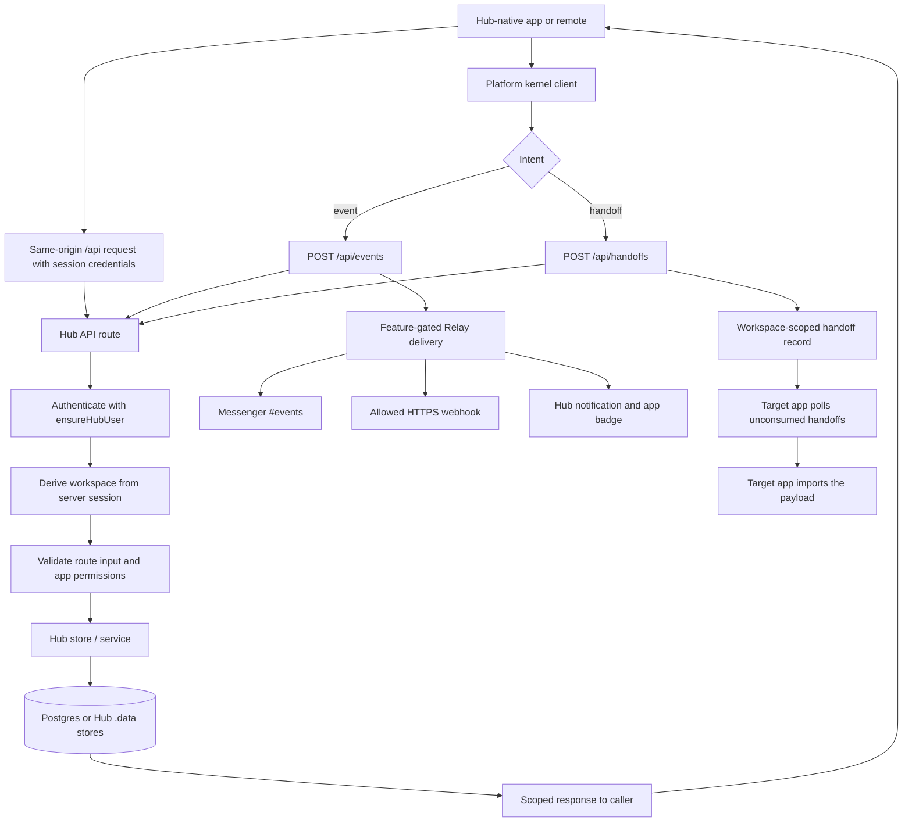
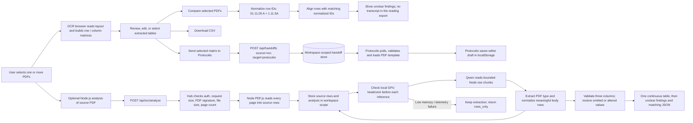
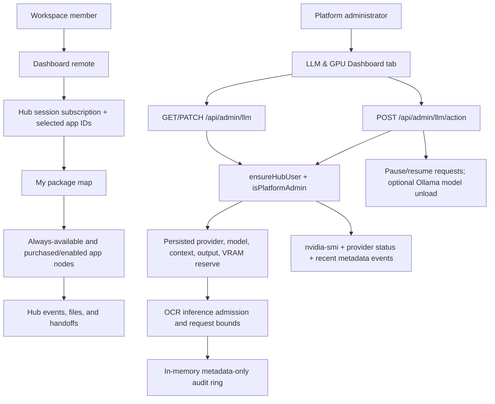

# Sorye app behavior tree

This is the static map of the main user and data flows in Sorye. It is intended to be read in the repository, in code review, or in a Markdown viewer that renders Mermaid. It has no controls or interaction.

For a self-contained local page with handler-by-handler node details, open [APP-BEHAVIOR-TREE.html](./APP-BEHAVIOR-TREE.html).

**Update rule:** when a code change adds, removes, or changes one of the flows, state owners, trust boundaries, or app integration edges below, update this diagram in the same change. Root [`AGENTS.md`](../AGENTS.md) makes this part of the repository-wide contribution process.

## Open an app and keep its state

```mermaid
flowchart TD
    Person[Person in browser] --> SignIn[Sign in / restore session]
    SignIn --> Identity[Hub resolves user and active workspace]
    Identity --> Shell[Hub shell]
    Shell --> Catalog[App launcher and catalog]
    Catalog --> Choose{App kind}

    Choose -->|Hub-native| Native[Catalog, Reports, Storefront, Site, Mail, Drive]
    Choose -->|Module Federation remote| Remote[Dashboard, Calendar, Notes, Tasks, Relay, Protocolio, Canvas, DevKit, Messenger, OCR, Studio]
    Choose -->|External app| Iframe[SUSM / ESPM iframe]

    Remote --> Mount[Remote exposes mount(container, kernel)]
    Native --> AppUI[App UI]
    Mount --> AppUI
    Iframe --> AppUI
    AppUI --> Refresh[Visible-page refresh; hidden or offline tabs pause]
    Refresh --> Notifications[Notifications: events plus 60-second safety refresh]
    Refresh --> SessionSync[Standalone workspace: focus, reconnect and 5-minute safety refresh]

    Shell --> PaneState[Pane selection and split layout]
    PaneState --> SessionStore[sessionStorage: sorye:hub:panes]
    AppUI --> AppState[App-private UI state]
    AppState --> Memory[React state while mounted]
    AppState --> AppPersistence[App-owned browser or Hub persistence]
    Memory --> KeepMounted[Switching panes hides visited apps; keeps them mounted for this Hub session]
    AppPersistence --> Reopen[Reopen / reload restores only the state that app explicitly saves]
    KeepMounted --> Reopen
```

`packages/platform/src/refresh.ts` owns bounded, non-overlapping background reads and coalesces event bursts. Full-page/standalone kernels use `sync.ts`: workspace and notifications refresh independently. The shell uses `use-hub-session.ts` for session revalidation and `use-notifications.tsx` for the same visible-only notification policy. Focus/visibility/reconnect refresh current data, and unmount aborts outstanding reads and removes timers/channels. Notification events do not refetch the standalone workspace. These reads are independent of Qwen work; analysis continues through its explicit analyze/continue requests.

## Shared app requests and cross-app work



Apps do not call each other directly. Shared APIs, events, and handoffs pass through Hub, which owns authentication and workspace scoping. Events use Relay; structured app-to-app payloads use the handoff store.

## OCR to Protocolio



The browser matrix path supports table review, multi-PDF alignment, CSV, and the Protocolio handoff. The separate Node path preserves every raw PDF row and asks the model for meaningful data in three columns: position/variable, description/calculation, period/result. `packages/types/src/ocr-table.ts` removes recognizable letterhead, repeated column headings, signatures and page numbers from the presentation; it preserves body notes, calculations and totals. It validates each AI cell against its source and restores missing or changed values into the same three columns. The reading page and JSON use this same projection, including for older saved readings, with filename, stored document ID and PDF type ID above a continuous table across all pages. Source page/row references remain in JSON. Unclear findings follow the table. Comparison matrices retain calculations and totals under their preceding position across page breaks. Hub GET responses apply the same normalization; raw stored pages remain unchanged. Inference resumes from the beginning if its stored prompt version is obsolete. Protocolio owns its editor draft; Hub pane state and OCR comparison/reading state have their own persistence lifetimes.

## Dashboard package map and LLM controls



The package map derives its visible app nodes from the authenticated workspace session; it does not accept plan or workspace identifiers from the browser. GPU controls are platform-admin-only. Prompt and PDF content are excluded from the audit log. The free-VRAM setting is an admission reserve, not a hard allocator limit. Ollama model unload does not stop its daemon; vLLM requires the service operator to stop its service.

## State ownership at a glance

| State | Owner | Persistence / lifetime |
|---|---|---|
| User, active workspace, app access | Hub | Auth and workspace store; server derives scope per request |
| Dashboard package map | Dashboard view | Derived from authenticated `HubSession` subscription and selected app IDs; no separate saved copy |
| LLM runtime settings | Hub | `.data/llm-control.json`; platform-admin API only |
| LLM activity events | Hub process | Metadata-only in-memory ring (last 500); cleared when the Hub process restarts |
| Open panes and split layout | Hub shell | `sessionStorage` for the current browser tab |
| Visited app's in-memory editor state | App component tree | Kept while that app stays mounted in the current Hub session |
| OCR selected reading | OCR remote | `sessionStorage` |
| OCR multi-document selection and comparison | OCR remote | App-owned `localStorage` record |
| Protocolio template and editor mode | Protocolio remote | App-owned `localStorage` draft |
| Shared records and app workflows | Hub APIs and stores | Postgres or `.data`, depending on configured store |
| Event delivery and structured handoffs | Hub | Workspace-scoped Hub stores; target app consumes/polls |

When a feature changes where state lives or how long it survives, update this table and the state branch above. Do not imply that all app state survives a full browser restart: that is true only where the app explicitly persists it.
