# Sorye app behavior tree


This is the static map of the main user and data flows in Sorye. It is intended to be read in the repository, in code review, or in a Markdown viewer that renders Mermaid. It has no controls or interaction.

For a self-contained local page with handler-by-handler node details, open [APP-BEHAVIOR-TREE.html](./APP-BEHAVIOR-TREE.html).

**Update rule:** when a code change adds, removes, or changes one of the flows, state owners, trust boundaries, or app integration edges below, update this diagram in the same change. Root [`AGENTS.md`](../AGENTS.md) makes this part of the repository-wide contribution process.

**Current cutover status:** Tasks, Notes, Calendar, Canvas, Site editing and published public reads, Storefront products and enquiry orders, workspace profile name/read paths, and Messenger text/channel resources use Rodrigo v2 through Hub. Browser writes persist in user/workspace-scoped IndexedDB queues and clear only after `committed` or `duplicate`. Messenger uses a channel-authorized timeline; image/blob sending and read receipts remain unavailable. Most other app and Hub-native state, binary storage, external jobs, event delivery, and Storefront status transitions remain uncovered. See [RODRIGO-DATA-CONTRACT.md](RODRIGO-DATA-CONTRACT.md) and [RODRIGO-DATABASE-SWITCHING-RUNBOOK.md](RODRIGO-DATABASE-SWITCHING-RUNBOOK.md).

## Open an app and keep its state

The standalone navbar Hub link uses the configured `VITE_HUB_ORIGIN` for remote apps and otherwise the current origin's `/`. The current host and port are preserved unless an explicit Hub origin is configured.

```mermaid
flowchart TD
    Person[Person in browser] --> SignIn[Sign in / restore session]
    SignIn --> Identity[Hub resolves user and active workspace]
    Identity --> Split[List APIs partition Personal and Work from session memberships]
    Split --> Shell[Hub shell]
    Shell --> Catalog[App launcher and catalog]
    Catalog --> Choose{App kind}

    Choose -->|Hub-native| Native[Catalog, Reports, Storefront, Site, Forms, Mail, Drive]
    Choose -->|Module Federation remote| Remote[Dashboard, Calendar, Notes, Tasks, Relay, Protocolio, Canvas, DevKit, Messenger, OCR, Studio]
    Choose -->|External app| Iframe[SUSM / ESPM iframe]

    Remote --> Mount[Remote exposes mount(container, kernel)]
    Native --> AppUI[App UI]
    Mount --> AppUI
    Iframe --> AppUI
    AppUI --> Refresh[Visible-page refresh; hidden or offline tabs pause]
    Refresh --> Notifications[Notifications: events plus 60-second safety refresh]
    Refresh --> SessionSync[Standalone workspace: focus, reconnect and 5-minute safety refresh]

    Shell --> PaneState[Pane selection and split layout]
    PaneState --> SessionStore[sessionStorage: sorye:hub:panes]
    AppUI --> AppState[App-private UI state]
    AppState --> Memory[React state while mounted]
    AppState --> AppPersistence[App-owned browser or Hub persistence]
    Memory --> KeepMounted[Switching panes hides visited apps; keeps them mounted for this Hub session]
    AppPersistence --> Reopen[Reopen / reload restores only the state that app explicitly saves]
    KeepMounted --> Reopen
```

Catalog, the launcher, and the App Library show each sold app's yearly running-cost minimum from `packages/types/src/running-cost.ts`. Those minima are shares of one stack. Added together they are the yearly amount that covers the shared host and the OCR GPU allowance. Catalog, Contact, and Reports stay included in that total.

`packages/platform/src/refresh.ts` owns bounded, non-overlapping background reads and coalesces event bursts. Full-page/standalone kernels use `sync.ts`: workspace and notifications refresh independently. The shell uses `use-hub-session.ts` for session revalidation and `use-notifications.tsx` for the same visible-only notification policy. Focus/visibility/reconnect refresh current data, and unmount aborts outstanding reads and removes timers/channels. Notification events do not refetch the standalone workspace. In Postgres mode, OCR submissions enter a durable Hub job queue; the OCR worker (`pnpm --filter @sorye/hub worker:ocr`, also started by local `pnpm dev` when `STORE_DRIVER=postgres`) extracts/analyzes the PDF and the mounted OCR app polls the authorized job endpoint for progress. Leaving OCR does not cancel that job. When the worker marks it completed or failed, Hub writes a notification for the submitting user in that workspace, and the Hub shell shows it whichever app is open. Opening the notification uses the same open-app path as the launcher and passes the analysis id. Opening OCR again asks Hub for the latest job and shows the finished reading or the existing error. The local JSON development path retains direct analyze/continue requests. The shell top bar Hub button returns to the app launcher; an open app stays mounted, the same path as dock Home and the workspace App grid control.

In Messenger, typing a person's name in a channel composer suggests people in that channel's workspace. Choosing one inserts a ping, and sending creates a notice for that person in the same Personal or Work scope. Opening the notice returns to that channel. A personal-channel ping is not offered or delivered when Messenger is outside that person's personal subscription. Team-channel pings follow team membership.

The product navbar is that shell top bar (`apps/hub/components/top-bar.tsx` and `language-selector.tsx`). It stays visible while an app is open. The language switcher and the Hub button live there; Hub calls `navigatePanel('launcher')`. Apps do not keep a second navbar. App-specific tools stay in the app. Edit this bar in those Hub files. Do not copy a private navbar into each remote.

Documents opened outside the shell use `StandaloneAppBar` from `@sorye/platform/react` (`packages/platform/src/chrome.tsx`): each remote Vite `main.tsx` via `StandaloneFrame`, `apps/hub/app/apps/[slug]/page.tsx`, and the OCR reading page `apps/hub/app/apps/ocr/reading/[id]/page.tsx`. That bar uses the same locales and links back to the Hub menu (`/` on Hub, or the Hub origin from a remote port). Edit standalone chrome only in `chrome.tsx`.

The full-page route `apps/hub/app/apps/[slug]/page.tsx` asks `/api/workspace` whether the app is on the workspace. While that answer is in flight it downloads the remote's code, except for admin-only apps. The remote is mounted and given a kernel client only after the answer allows it. A denied app shows the not-available page and no app UI. Browser session state comes from `/api/workspace`; Hub does not mount the Auth.js `SessionProvider`, so pages do not poll `/api/auth/session`.

## Shared app requests and cross-app work

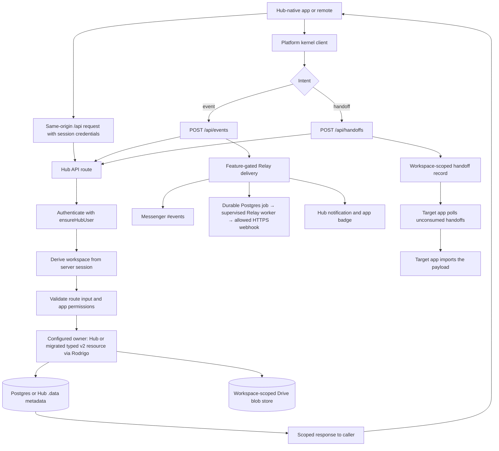

Apps do not call each other directly. Shared APIs, events, and handoffs pass through Hub, which owns authentication and workspace scoping. Events use Relay; structured app-to-app payloads use the handoff store.

Canvas board data now reads and writes through Rodrigo v2. The existing Canvas `LISTEN/NOTIFY` SSE path is still Hub-owned and v2 actions do not yet publish invalidations, so other open tabs may need to reload. Presence remains ephemeral and process-local; it is not durable board data.

Tasks saves its typed `taskBoard` aggregate as a v2 action. Clicking a card opens that task as a ticket on the board. The ticket id is the task id, unique in the workspace, and a coworker with Tasks access opens `/apps/tasks?ticket=<id>` or pastes the id. The link does not choose a workspace. Pasted or dropped images are uploaded to Hub Drive with `sourceAppId` `tasks` (the Tasks section in Drive) and the board stores `attachmentIds` only; a legacy `driveFileId` is accepted as one image until the next save. Rodrigo does not own those bytes. Moving or saving a task keeps its label, description, image ids, and status. Notes and Calendar save typed resources the same way; Canvas boards, Site pages, Storefront products and enquiry orders, and workspace profile name writes use the same Hub gateway. IndexedDB stores each stable action ID and payload before Hub checks the active user/workspace queue scope and signs the request. Rodrigo commits each resource and receipt atomically in PostgreSQL. A published Site page also reserves its slug in that transaction. Visitors read `/s/{slug}` through a reserved Hub service assertion; the browser does not choose the workspace. Order lines are checked against the current product price before the receipt commits. Updates carry resource revisions; conflicts stay queued for explicit reconciliation. Outages leave actions in IndexedDB with pending/failure state and Resend. Legacy resource writers are disabled for migrated slices, while unrelated legacy paths remain active and are listed in the contract inventory. Relay publish and order-placed events are not part of these commits.

## OCR to Protocolio

```mermaid
flowchart LR
    User[User selects one or more PDFs] --> BrowserRead[OCR browser reads layout and builds row / column matrices]
    BrowserRead --> MatrixReview[Review, edit, or select extracted tables]
    MatrixReview --> Combine[Compare selected PDFs]
    Combine --> Normalize[Normalize row IDs: 01.11.05 A = 1.11.5A]
    Normalize --> Merge[Align rows with matching normalized IDs]
    Merge --> Findings[Show unclear findings; no transcript in the reading export]
    MatrixReview --> CSV[Download CSV]

    User --> Analyze[Optional Node.js analysis of source PDF]
    Analyze --> UploadAPI[POST /api/ocr/analyze]
    UploadAPI --> Limits[Hub checks auth and bounded upload]
    Limits --> Driver{Store mode}
    Driver -->|Postgres| Queue[(Durable bounded job queue)]
    Queue --> Poll[OCR remote polls authorized job status]
    Queue --> Worker[Separate OCR worker with shared GPU admission]
    Worker --> PdfJs[Node PDF.js reads every page into source rows]
    Driver -->|Local JSON development| PdfJs
    PdfJs --> Save[Store source rows and analysis in workspace scope]
    Save --> GPU[Check local GPU headroom before each inference]
    GPU --> Qwen[Qwen reads bounded Node row chunks]
    Qwen --> Pattern[Extract PDF type and normalize meaningful body rows]
    Pattern --> Complete[Validate three columns; restore omitted or altered values]
    Complete --> Table[One continuous table, then unclear findings and matching JSON]
    Pattern --> Save
    GPU -->|Low memory / telemetry failure| RowsOnly[Keep extraction; return rows_only]

    MatrixReview --> Send[Send selected matrix to Protocolio]
    Send --> HandoffAPI[POST /api/handoffs: source=ocr, target=protocolio]
    HandoffAPI --> HandoffStore[(Workspace-scoped handoff store)]
    HandoffStore --> Protocolio[Protocolio polls, validates and loads PDF template]
    Protocolio --> Draft[Protocolio saves editor draft in localStorage]
```

The browser matrix path supports table review, multi-PDF alignment, CSV, and the Protocolio handoff. The separate Node path preserves every raw PDF row and asks the model for meaningful data in three columns: position/variable, description/calculation, period/result. A transcript that fits the model context is one request, with generated tokens capped to that pattern. Longer documents stay in bounded chunks, checkpoint, and continue. The model stays loaded across the slices of a job and is unloaded when the job finishes. In Postgres mode, OCR work is durably queued and handled outside the interactive Hub request; progress is available through the workspace/user-authorized job status endpoint. The OCR screen shows elapsed model time as `GPU m:ss` from the first model-request timestamp (`vector.gpuStartedAt`) until model work finishes (`vector.gpuFinishedAt`). Queue wait and PDF row extraction are not included. The normalized table scrolls inside a 22rem region with its header kept visible. A database-backed heartbeat must be fresh before uploads are accepted. Local `pnpm dev` starts that worker when the store driver is postgres; a stopped worker rejects the upload instead of asking for a short retry. The worker lease is renewed while processing, and cancellation/lost ownership aborts ongoing work between PDF pages and model batches. Leaving the OCR app does not cancel the queued job. Completion and failure are recorded by the worker through the shared background-job hook, which writes one Hub notification for the submitting user in that workspace only. The notification title distinguishes success from failure and, on success, carries the analysis id. Clicking it uses the Hub open-app event (`sorye:hub:open-app`) with that analysis id. Returning to OCR without the notification calls `GET /api/ocr/active` (session user and workspace; no client workspace id) and shows the finished reading, the existing error, or resumes `GET /api/jobs/:id` while the job is still running. A client WebGPU pass still finishes in the open tab and the stored analysis remains what OCR shows if the user moves to another Hub app and comes back. The local JSON development path remains direct and process-local. `packages/types/src/ocr-table.ts` removes recognizable letterhead, repeated column headings, signatures and page numbers from the presentation; it preserves body notes, calculations and totals. It validates each AI cell against its source and restores missing or changed values into the same three columns. The reading page and JSON use this same projection, including for older saved readings, with filename, stored document ID and PDF type ID above a continuous table across all pages. Source page/row references remain in JSON. Unclear findings follow the table. Comparison matrices retain calculations and totals under their preceding position across page breaks. Hub GET responses apply the same normalization; raw stored pages remain unchanged. Inference resumes from the beginning if its stored prompt version is obsolete. Protocolio owns its editor draft; Hub pane state and OCR comparison/reading state have their own persistence lifetimes.

## OCR finishes after the user leaves

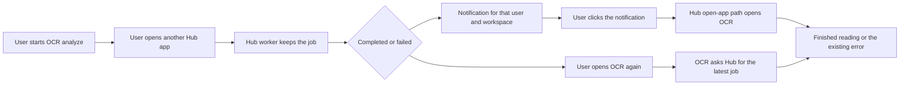

The job stays on Hub. OCR does not need to stay mounted, and unmounting does not cancel it. The shell notification center and toasts are the existing Hub notification UI. A different workspace does not receive the notice.

## Dashboard package map and GPU preference

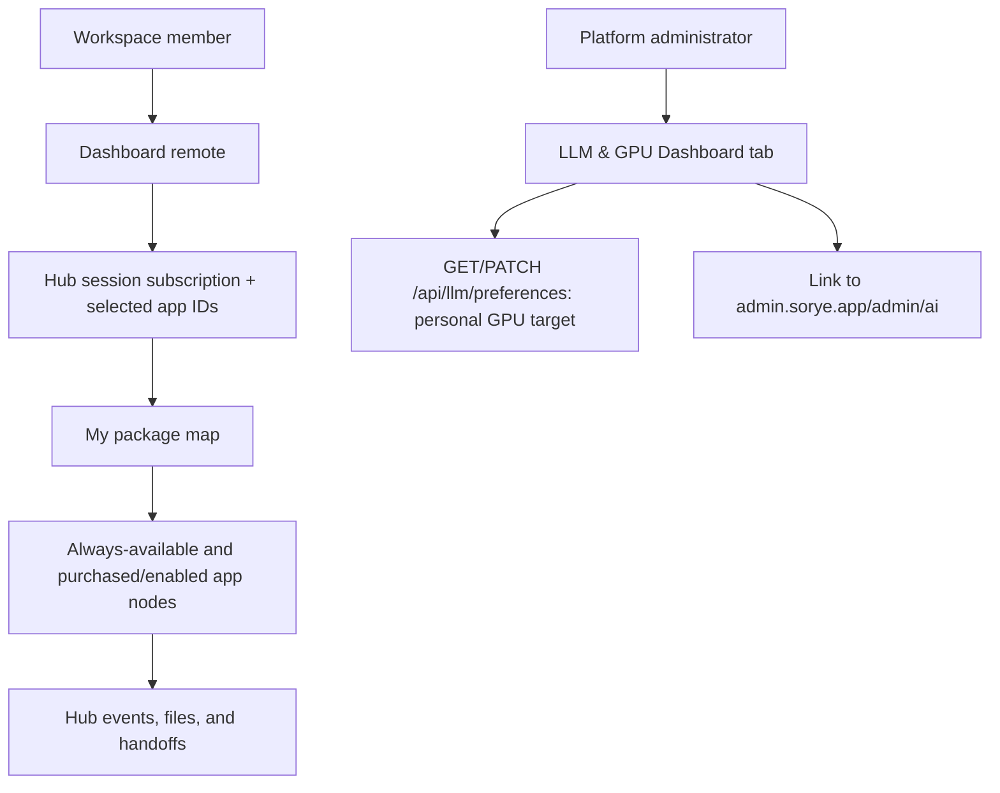

The package map derives its visible app nodes from the authenticated workspace session; it does not accept plan or workspace identifiers from the browser. The Dashboard tab keeps only the signed-in user's GPU preference; the shared engine moved to the administration console (next section).

## Administration console and shared AI configuration

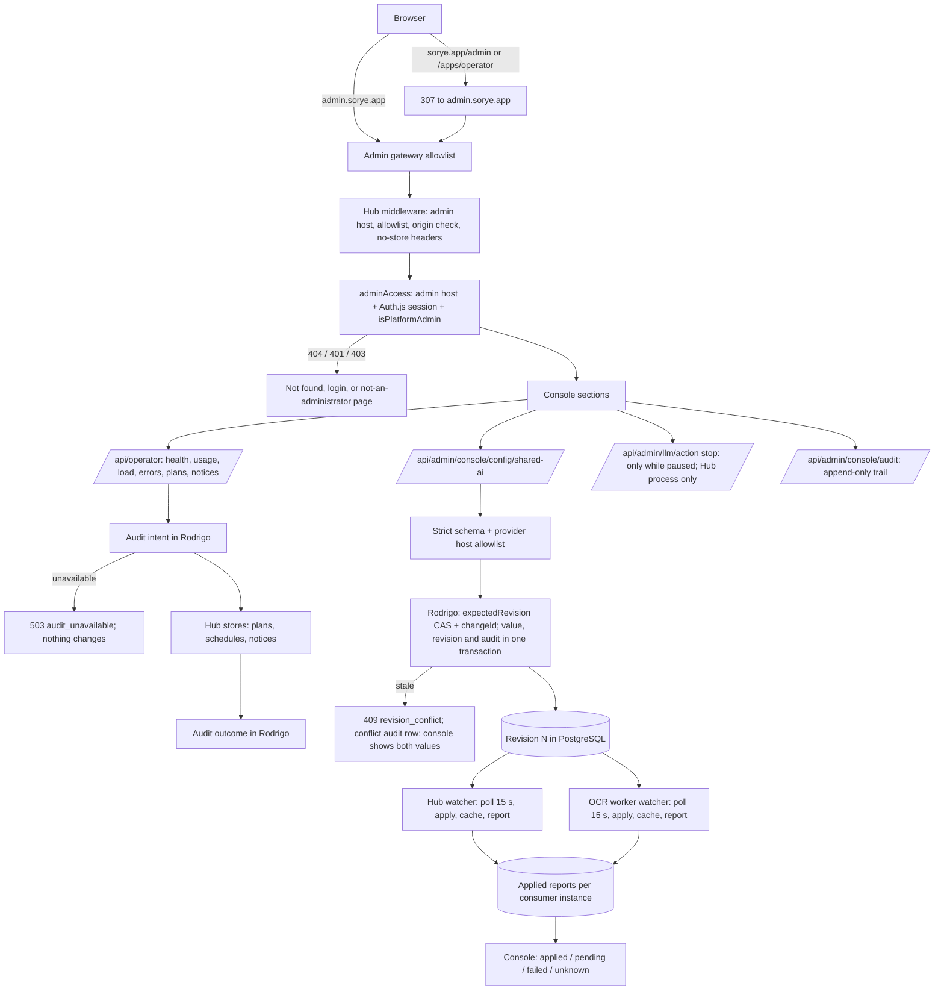

The redirect is not the protection; every console page and API repeats the host, session and administrator checks. Cookies are host-only, so admin and customer sessions never cross. Pause is configuration: each consumer refuses new AI requests after applying the paused revision, and requests already running finish. Stop aborts this Hub's requests and unloads the Ollama model; it does not cancel OCR worker jobs in progress. When Rodrigo is unreachable, each consumer keeps its last applied revision (from disk after a restart) and the console shows the store as unavailable and propagation as unknown. Settings precedence is Rodrigo revision, then the legacy `llm-control.json` settings, then `OCR_LLM_*` environment. Prompt and PDF content are excluded from logs and audit. The free-VRAM setting is an admission reserve, not a hard allocator limit. See the [runbook](admin/ADMIN-CONSOLE-RUNBOOK.md).

## Rodrigo discovery boundary

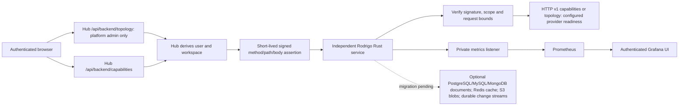

Rodrigo is a separate repository and service. Tasks v2 actions and snapshots use the signed Hub gateway and PostgreSQL-backed typed service; this cutover does not imply migration of other apps. The Hub does not fall back to its legacy Tasks store when Rodrigo is unavailable. Other app data and external workflows still have separate owners and require their own cutovers. See [RODRIGO.md](./RODRIGO.md).

## Tasks v2 action ownership; Calendar remains legacy

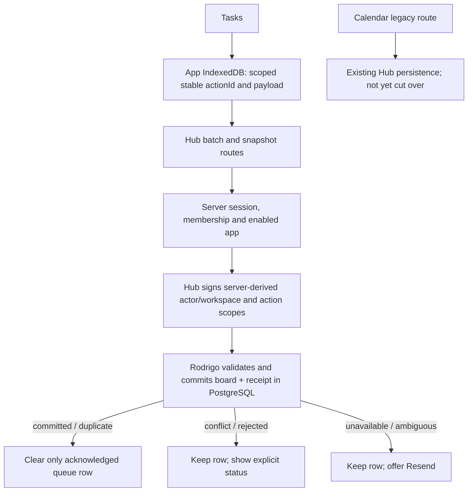

Tasks has no owner toggle or Hub fallback: v2 reads and writes go to Rodrigo, missing data yields the typed default board, and its legacy PUT is disabled. Calendar and Notes remain Hub-owned and are uncovered by this step. Identity, general events and handoffs remain in Hub.

## State ownership at a glance

| State | Owner | Persistence / lifetime |
|---|---|---|
| User, active workspace, app access | Hub | Auth and workspace store; server derives scope per request |
| Personal and Work lists | Hub `partitionUserLoad` | Groups from `session.workspaces`. Personal rows are returned only when that app is in the viewer's personal subscription (selected apps plus always-available apps). Team lists are not filtered by the personal package. UI renders the split; `mergeUserLoad` is not sent to clients |
| Dashboard package map | Dashboard view | Derived from authenticated `HubSession` subscription and selected app IDs; no separate saved copy |
| Shared AI engine settings | Rodrigo platform config (`shared-ai`) | Revisioned in PostgreSQL; written only from the administration console; each Hub and OCR worker process keeps its applied revision in memory and in `.data/platform-config/<consumer>-shared-ai.json` |
| Personal GPU preference | Hub | `.data/llm-control.json` `userGpuPreferences` (`client-webgpu` vs `hub-server`), per user, mirrored in browser `localStorage` |
| Administration audit trail | Rodrigo | Append-only PostgreSQL table; configuration rows atomic with revisions, Hub action rows as intent then outcome |
| Hub MCP assistant overlay | Hub shell + `/api/mcp/*` | Permission-scoped to `HubSession` (`selectedAppIds` + `isAdmin`); never accesses backend databases directly; emits Hub events and forwards domain reads/writes to Rodrigo via signed assertions. Workspace questions route to tools (ownership, My day, tasks, quick capture, calendar, OCR, Drive, switch workspace via `/api/workspace/team`); other questions go to the server model without tools, or a built-in responder when it is paused or offline. The tool list and the server GPU preference load when the overlay opens, not on every shell load |
| LLM activity events | Hub process | Metadata-only in-memory ring (last 500); cleared when the Hub process restarts |
| Open panes and split layout | Hub shell | `sessionStorage` for the current browser tab |
| Visited app's in-memory editor state | App component tree | Kept while that app stays mounted in the current Hub session |
| OCR selected reading | OCR remote | `sessionStorage`, plus the latest Hub job when OCR mounts again |
| OCR job finish notice | Hub notification store | Written when the background job completes or fails; visible only to the submitting user in that workspace |
| OCR multi-document selection and comparison | OCR remote | App-owned `localStorage` record |
| Tasks pending actions | Tasks remote | IndexedDB partitioned by server-derived user/workspace hash; cleared only for Rodrigo `committed` or `duplicate`; conflicts require explicit reconciliation |
| Notes/Calendar stale-save draft | Respective remote | Existing app-specific behavior; not covered by the Tasks cutover |
| Protocolio template and editor mode | Protocolio remote | App-owned `localStorage` draft |
| Tasks board | Rodrigo via Hub v2 | PostgreSQL typed `taskBoard` resource and atomic idempotency receipt; board revision controls concurrency |
| Notes/Calendar records | Existing Hub routes and stores | Legacy owners remain active pending their own cutover |
| Other shared records and app workflows | Hub APIs and stores | Postgres or `.data`, depending on configured store |
| Event delivery and structured handoffs | Hub | Workspace-scoped Hub stores; target app consumes/polls |

When a feature changes where state lives or how long it survives, update this table and the state branch above. Do not imply that all app state survives a full browser restart: that is true only where the app explicitly persists it.

## Forms: build, publish, collect

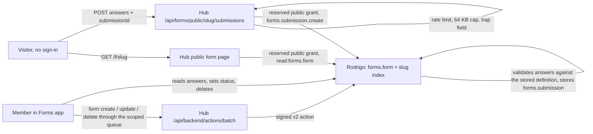

A member builds a form in the Hub-native Forms app. Saves are typed `forms.form` actions through the app's scoped IndexedDB queue; Rodrigo reserves the public slug in the same transaction. `/f/<slug>` and the two `/api/forms/public/` routes need no sign-in. The slug selects the form, never a workspace: Rodrigo resolves the owner, validates every answer against the stored definition, stamps the time and stores the submission. `submissionId` makes a retry safe. Members can change a submission's status or delete it; they cannot create one or edit its answers. Hub does not learn which workspace received a submission, so no event, notification or badge is raised. An unpublished, deleted or unknown slug is 404; a form that is not accepting shows a closed message.

| State | Owner | Lifetime |
|---|---|---|
| Form definitions, slug index, submissions | Rodrigo (PostgreSQL) | Until a member deletes them |
| Unconfirmed form edits | Forms scoped IndexedDB queue | Until Rodrigo confirms or the member discards |
| Draft being edited, selected tab | Forms component state | Until the app unmounts |
| Anonymous rate-limit windows | Hub process memory | One minute per window, per replica |

## Plans and self-service billing

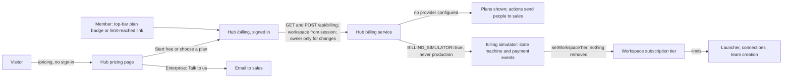

Plans belong to a workspace and only its owner changes them; the workspace comes from the server session. No payment provider is connected: in production every plan action explains that and links to sales, and administrators still assign plans in the administration console. With the local/test simulator on, upgrades apply at once, paid downgrades and cancellations wait for the end of the period, and failed payments move through past due and a 7-day grace period before Free. Going over a limit locks the newest apps and connections instead of deleting them; the Plan & billing page reports the locked counts (the launcher does not yet hide locked items). Flows, states and the provider plan: [SUBSCRIPTIONS.md](SUBSCRIPTIONS.md).

| State | Owner | Lifetime |
|-------|-------|----------|
| Tier that limits apply to | Hub workspace record (`subscriptionId`) | Until the next plan change |
| Billing state in test mode (status, period, schedule, grace) | Hub `.data/billing-simulator.json` | Local/test only; deleted by hand |
| Selected billing period on the page | `/billing` and `/pricing` component state | Until the page closes |

## Own upload storage (drive or database)

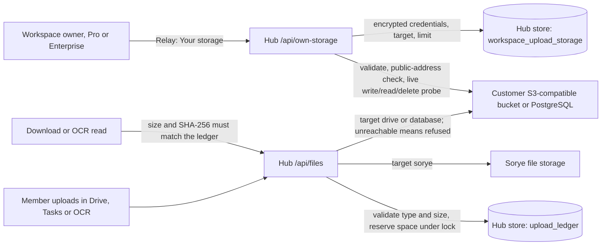

Only the workspace owner on Pro or Enterprise changes the destination or connections; the workspace comes from the session. Uploads go to the chosen destination and never fall back to Sorye storage. Each file records where its bytes are, so switching the destination later does not move existing files. Customer bytes are checked against the stored SHA-256 before they are served. A connection cannot be removed while it is the target or still holds files. The workspace app-data database setting (`/api/workspace/storage`) follows the same owner, plan, network and TLS rules. Design and threat model: [OWN-STORAGE.md](OWN-STORAGE.md).

| State | Owner | Lifetime |
|-------|-------|----------|
| Upload destination, connection settings, encrypted credentials, limits | Hub `workspace_upload_storage` (JSON: `.data/own-storage.json`) | Until the owner changes or disconnects it |
| Upload record (who, what, where, size, SHA-256, status) | Hub `upload_ledger` | Kept after the file is deleted |
| File bytes on own storage | Customer bucket (`prefix/workspace/file-id`) or `schema.files` | Until the file is deleted in Sorye |

## API keys and headless callers

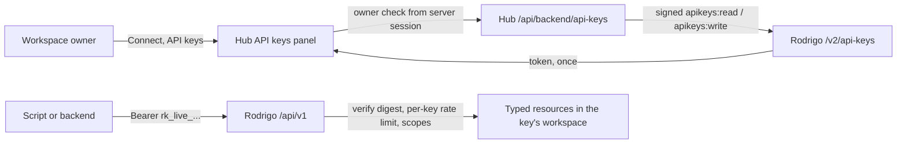

The owner creates a key in Hub; Rodrigo mints it and stores only its digest. The token is shown once and Hub keeps no copy. From then on the caller talks to Rodrigo's `/api/v1/` directly: Hub is not in the path. A key acts as `apikey-<keyId>` inside its own workspace, limited to its scopes, and reaches Tasks, Notes, Calendar and Forms. Revoking a key takes effect on its next request. API keys are refused on Hub-signed routes and Hub assertions are refused on `/api/v1/`.

| State | Owner | Lifetime |
|---|---|---|
| Key digest, workspace, scopes, timestamps | Rodrigo (PostgreSQL) | Until revoked; revoked rows are kept for the record |
| The token | The owner who copied it | Shown once; not recoverable |
| Per-key request windows | Rodrigo process memory | One minute, per replica |

## Public app introductions

Visitor ? catalog-slug.sorye.app/ (DNS/TLS routed to Hub) ? Hub rewrites to /learn/slug ? public app description ? Open app on https://sorye.app ? existing sign-in and workspace authorization ? app. Direct /learn/slug links are public too. Unknown slugs return 404; unknown hosts do not select an app. Hub owns static landing copy; no workspace data is read and no app is mounted by the landing page.

## Platform notices and metrics

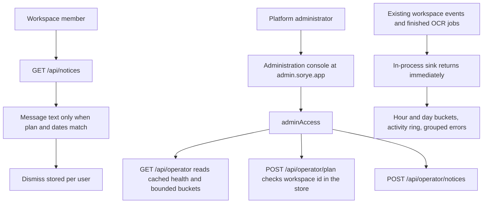

The former Operator app is retired; its views are console sections and its catalog id is ignored in stored selections. Metrics are queued after the user-facing work and dropped if the buffer is full. Health probes run for the console and are cached for a few seconds. Notices store the message, audience, dates, and active flag on the server. Members receive the message text only. A future plan date is stored as a schedule; the plan catalog still owns `maxApps`. No card payment is collected here.

## Language preference

Hub language selector ? browser-owned sorye:locale localStorage ? same-document locale event / cross-tab storage event ? subscribed app controls. Supported locales: en, de, sk, hu, es. Server rendering defaults to English. This changes presentation only, not workspace records. Current translated coverage is shared controls plus Tasks, Messenger, Calendar, Notes, Forms (builder and public page), API keys, Pricing and Plan & billing, and Relay's Your storage tab; other app-specific copy (including the per-app "How to use" banner) remains English. Inside an open app the switcher is the shell top bar. Standalone pages outside the shell use the same locales through `StandaloneAppBar`.

Public landing pages use /learn/<slug>/<locale> for en, de, sk, hu and es. Each URL renders translated text and metadata on the server, has a self-canonical URL and hreflang alternatives, and is listed in the sitemap. Language links preserve the app. Unqualified landing URLs and catalog subdomain roots select the best supported Accept-Language preference (English fallback) with a private, non-cacheable temporary redirect; esp redirects to es. The URL owns landing language, independently of the workspace browser preference. Unsupported languages return 404. New apps must add all five translations; preserve limitations in every translation.

Protocolio editor → authenticated Hub generate/validate/health endpoints → separate Protocolio renderer and its MongoDB. SDK source belongs to the Protocolio repository; Sorye consumes a versioned archive. Browser generation no longer falls back to direct engine access. See PROTOCOLIO.md for deployment and credentials.

## Independent app subdomain deployment

The deployment files in `deploy/` provide one image and Dockyard registration per catalog app. Eleven remote images contain their compiled federation assets at `/remote/`; the remaining images are gateways to Hub-native or externally embedded apps, not extracted implementations. Each gateway redirects `/` to `/apps/<slug>` and forwards authenticated pages and APIs to the single Hub. Contact remains a presentation page. Public introductions remain at `/learn/<slug>/<locale>`. Existing direct-to-Hub subdomain routing still serves introductions until ingress is switched to the app gateway.

Hub owns sessions, workspace authorization and records. Gateways have no persistent application data. Hub `.data` is mounted on a named volume; back it up before replacement. App landing descriptions were reviewed: capabilities and limitations remain accurate; deployment changes do not add product features.

## Target Hub and Rodrigo boundary (migration pending)

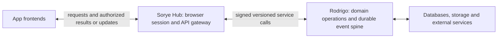

Hub remains the browser-facing authentication and API gateway. Apps never bypass Hub to call Rodrigo or databases. Rodrigo v2 action/read routes are live only for the slices listed at the top of this document; other stores, general events, and jobs still run in Hub. Rodrigo readiness depends on configured providers and does not prove migration. The no-migration cutover may make Hub-owned records unavailable. See [ownership, migration and release contracts](HUB-RODRIGO-BOUNDARY.md).

### Deployed OCR worker

The separately registered OCR worker image consumes Hub's PostgreSQL job queue and shares Hub's file storage on the same Docker host. It owns no browser session or public API. Its health requires a fresh successful database heartbeat from that worker process; Hub rejects new OCR submissions when no worker heartbeat is live. Gateways allow 65 MiB requests while Hub bounds PDFs to 64 MiB plus multipart overhead. See [worker deployment](../deploy/README.md#ocr-worker-deployment) for volumes, credentials and recovery.
