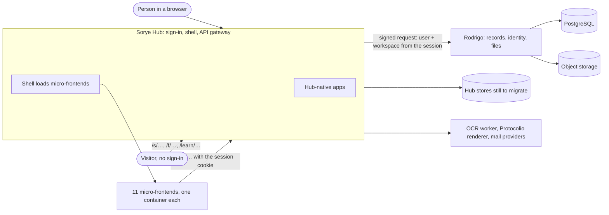

# Sorye apps at a glance: who handles what

A one-page map of every app: what it does, where it runs, where its data lives, what it talks to, and its current limits. It describes the integrated code (Hub/Rodrigo alignment slices 0–2 plus the Site builder). Details per app are in [apps/APPS.md](apps/APPS.md); flows are in the [behavior map](APP-BEHAVIOR-TREE.md); migration status is in [HUB-RODRIGO-ALIGNMENT.md](HUB-RODRIGO-ALIGNMENT.md).

Explore the connections, storage, GPU and telemetry in the [interactive Sorye ↔ Rodrigo architecture guide](SORYE-RODRIGO-EXPLORER.html). It works offline and distinguishes implemented, optional, planned and sandbox paths.

## The shape of the system

- **Hub** signs people in, shows the launcher and top bar, hosts every app, and is the only thing a browser talks to. It checks the session, the workspace and app access, then signs each call to Rodrigo.
- **Rodrigo** owns the data that has been migrated: users, workspaces and membership, typed app records, files and site media. Apps never call Rodrigo, a database or each other directly.
- **Two kinds of app.** *Micro-frontends* are separate bundles, each served by its own container and mounted by the Hub shell. *Hub-native* apps are screens inside Hub itself (no container, no port).
- **Writes** from migrated apps wait in a queue in the browser (IndexedDB) and count as saved only when Rodrigo confirms them. If Rodrigo is down, the change stays queued with a "send again" action.

## Every app

"Sandbox port" is where the app's container is published in the local sandbox; Hub is `http://localhost:23000`.

| App | What it does | Runs as | Data owner today | Talks to | Current limits |
|---|---|---|---|---|---|
| **Catalog** | Lists every app with its yearly running-cost share; opens the App Library | Hub-native, always on | None (reads the app catalog in code) | — | — |
| **Dashboard** | Workspace overview: metrics, work by app, the App events switch, embed and database guides | Micro-frontend, port 23101 | Hub stores (events, embed widgets) | Hub `/api/events`, `/api/workspace` | Not migrated to Rodrigo |
| **Tasks** | Kanban board; each card opens as a ticket with images | Micro-frontend, 23102 | Rodrigo (`tasks.taskBoard`); images are Drive files | Hub action batch; Drive uploads | Event notifications still from Hub |
| **Calendar** | Month view with timed, all-day and multi-date events | Micro-frontend, 23103 | Rodrigo (`calendar.event`) | Hub action batch | Event notifications still from Hub |
| **Notes** | Simple note editor | Micro-frontend, 23104 | Rodrigo (`notes.note`) | Hub action batch | — |
| **Messenger** | Workspace chat: channels, direct messages; `#events` receives Relay messages | Micro-frontend, 23105 | Rodrigo (channels, text messages) | Hub action batch, timeline reads | Attachments and read receipts not available |
| **Canvas** | Shared whiteboard with sticky notes and shapes | Micro-frontend, 23106 | Rodrigo (`canvas.board`) | Hub action batch; live updates from Hub | Live invalidation still Hub-owned |
| **Relay** | Chooses which app events go to Messenger, webhooks or email; shows deliveries; "Your storage" and cloud folders | Micro-frontend, 23107 | Routing rules and delivery log: Hub store. Own-storage settings and cloud folders: Rodrigo | Hub `/api/relay`, `/api/own-storage` | Email and WhatsApp queue but do not deliver; event delivery moves to Rodrigo in alignment slice 3 |
| **OCR** | Extracts tables and a transcript from PDFs; optional AI analysis; sends a layout to Protocolio | Micro-frontend, 23108 | Jobs and results: Hub store; PDFs: Drive | Hub `/api/ocr`, OCR worker, handoff to Protocolio | Needs a live worker; AI needs a configured model; not migrated (slice 4) |
| **Studio** | Opens a 3D model and lets you orbit it (WebGPU) | Micro-frontend, 23109 | Files in Drive (section "studio"); viewing is in the browser | Drive | No STEP/IGES/.blend; needs a WebGPU browser |
| **DevKit** | API explorer, embed lab, webhook simulator, logs | Micro-frontend, 23110 | Hub stores (embed widgets, logs) | Hub APIs | For developers; not migrated |
| **Protocolio** | Builds a PDF layout and generates the PDF | Micro-frontend, 23111 | The layout lives in the open editor (not saved by Sorye); PDFs are produced by the separate Protocolio service | Hub `/api/protocolio/*` bridge to the renderer; receives OCR handoffs; emits events | Renderer is a separate service; unavailable on the isolated sandbox network |
| **Drive** (id `files`) | Workspace folders, folder-tree uploads, search, safe previews, rename, download, delete; blocks executable files | Hub-native | Rodrigo (folder/file records, quota, ledger; selected object storage owns bytes) | Hub folder/file APIs and shell upload queue | 64 MiB/file, 200 files/workspace; folders up to 2,000 |
| **Site** | Website builder: pages from sections, collections, media, contact forms, languages; publishes to `/s/<address>` | Hub-native | Rodrigo (`site.*` records, revisions, media bytes) | Hub action batch, `/api/site/*`; public pages read the live revision | Form forwarding to Messenger/Relay **not active**; no custom domains |
| **Forms** | Build a form, publish at `/f/<address>`, read answers, export CSV | Hub-native | Rodrigo (`forms.form`, `forms.submission`) | Hub action batch; public form routes | No notification on a new answer; no file fields |
| **Storefront** | Browse workspace products and send an order request | Hub-native | Rodrigo (`storefront.product`, `storefront.order`) | Hub action batch; Site's Product showcase shows its products | No payment; order status changes are not a workflow yet |
| **Mail** | Workspace mailbox plus connected Gmail/Outlook/IMAP accounts | Hub-native | Hub stores (mailbox, account credentials) | Mail providers over IMAP/SMTP | Not a public mail server; moves to Rodrigo in slice 5 |
| **Reports** | Charts of event volume, app mix and failed deliveries | Hub-native, administrators only, always on | Hub event store | Hub `/api/events` | Shows counts only, never message or file contents |
| **Contact** | Public page about Sorye with a contact dialog | Hub page (`/contact`), not in the launcher | None | Opens a `mailto:` | No mailer |

Not apps: the **administration console** (admin host only; platform settings, plans, audit) and the public **app introductions** at `/learn/<app>/<language>`. Retired: Operator, SUSM, ESPM.

## How apps work together

Apps do not call each other. They cooperate in four ways, all through Hub:

| Mechanism | Example | Status |
|---|---|---|
| **Events** — an app reports that something happened; Relay rules forward it | OCR finished → message in Messenger `#events` or a webhook | Works through Hub today; moving to Rodrigo's durable event log (slice 3) |
| **Handoffs** — one app passes a payload to another | OCR sends a table layout to Protocolio | Works through Hub |
| **Shared files** — apps store files in Drive under their own section | Tasks images, OCR PDFs, Studio models | Works; bytes in Rodrigo |
| **Shared records read by Hub** — one app shows another's public data | Site's Product showcase lists Storefront products | Works (read by Rodrigo for public pages) |

## What is public (no sign-in)

| URL | Served by | Shows |
|---|---|---|
| `/s/<address>` and `/s/<address>/<language>/…` | Site | The published website only |
| `/f/<address>` | Forms | One published form |
| `/learn/<app>/<language>` | Hub | App introductions |
| `/contact`, `/pricing` | Hub | Presentation pages |

Everything else needs a signed-in member of the workspace with that app enabled.

## Migration status in one line each

- **In Rodrigo now:** identity and membership; Tasks, Notes, Calendar, Canvas, Messenger text, Storefront, Forms, Site; Drive files, own storage, Relay cloud folders.
- **Still in Hub stores:** events and Relay delivery, notifications, OCR jobs, Mail, Dashboard/DevKit data, Reports statistics, billing state.
- **Order of the remaining work:** events and notifications (3), jobs (4), mail (5), remaining domains (6), compute services (7), removal of Hub stores (8).
