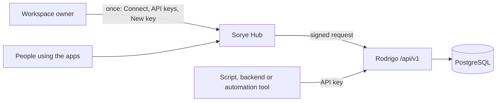

# Using Sorye without the web app

Sorye can be used from your own software. The web app (Hub) is needed once, to create an API key. After that, calls go straight to Rodrigo and Hub is not involved.

The caller's guide, with endpoints, examples, limits and errors, is Rodrigo's `docs/PUBLIC-API.md`. This page records how the two repositories divide the work and what is still missing.

## How it works

1. A workspace owner opens Connect → API keys in Hub and creates a key with a name and scopes. Hub checks ownership from the server session and asks Rodrigo to mint the key with a signed request (`/api/backend/api-keys` → `POST /v2/api-keys`). The key is shown once. Hub does not store or log it.
2. Rodrigo keeps only the key's SHA-256 digest, with its workspace and scopes.
3. The caller sends `Authorization: Bearer rk_live_...` to `/api/v1/` on the address the operator publishes (`RODRIGO_PUBLIC_API_URL` in Hub's environment is only the text shown to owners). Rodrigo verifies the key, applies the per-key rate limit and runs the request inside the key's workspace.
4. Reads and writes use the same typed validation, idempotency receipts and conditional revisions as the Hub path, so data written by a script and data written in the app are the same records.

Hub assertions and API keys are separate credentials. Neither is accepted on the other's routes.

## What is reachable today

| Area | Headless through `/api/v1` | Notes |
|---|---|---|
| Tasks, Notes, Calendar | Yes | Full read and write |
| Forms | Yes | Definitions read and write; submission status and delete. New submissions arrive through the public form page, which also needs no sign-in |
| Canvas, Site, Storefront, workspace profile, Messenger text | No. Stored in Rodrigo, but not exposed | Their rules are partly enforced in Hub (owner-only edits, order prices, channel membership). Each needs those rules moved into Rodrigo before a key may reach it |
| Mail, Drive files, Relay, events, notifications, handoffs, OCR, embed widgets, identity and plans | No. Still owned by Hub | Not in Rodrigo yet. See the order below |
| Protocolio PDF generation | No | Separate service with its own database |

## What still has to move into Rodrigo

In the order that unlocks the most for headless use:

1. **Rule enforcement for data already in Rodrigo.** Site (owner-only), Storefront products and orders (owner-only products, price checks, order ownership), Canvas, Messenger (membership and mentions). Rodrigo needs a workspace-role fact it can trust, which today only Hub knows. This is the identity bootstrap contract described in [the boundary document](HUB-RODRIGO-BOUNDARY.md).
2. **Workspace events and webhooks.** Events, Relay routing and notifications are Hub stores and a Hub worker. A headless caller cannot subscribe to changes until Rodrigo owns a durable event stream and webhook delivery.
3. **Files.** Drive bytes and metadata are Hub-owned; Rodrigo's blob API is limited to 256 KB objects. Larger uploads need a multipart or presigned-upload contract.
4. **Durable jobs.** OCR analysis, reminders and scheduled work run as Hub workers. Rodrigo has no job API yet.
5. **Mail, embed widgets, handoffs.** Hub stores with their own credentials and delivery paths.
6. **Identity, membership and plans.** The last to move, because every other rule depends on it.

Each move follows the one-writer rule in the boundary document: Rodrigo contract and tests first, then Hub forwards, then the Hub store and its credentials are removed. No dual writes and no silent fallback.

## Operating it

- Apply Rodrigo migration `007_api_keys.sql` before deploying a Rodrigo build with this API.
- Publish only `/api/v1/` on the public address. Keep `/v1/` and `/v2/` private to Hub.
- Set `RODRIGO_PUBLIC_API_URL` in Hub so owners see the address next to their keys.
- Limits are per key and per replica (600 requests a minute). They protect the service; plan quotas are not enforced yet.
