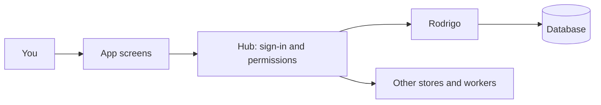

# How the apps connect

**Hub brings the apps together. Rodrigo handles the backend operations already moved to it.** You sign in once and work inside an authorized workspace.

## From opening an app to saving a change

1. **Sign in.** Hub identifies you and checks your workspace access.
2. **Choose an app.** Hub opens its screen, either loaded separately or built into Hub.
3. **Make a change.** The screen asks Hub to save it. Hub checks permissions and the request.
4. **Store it.** Hub sends migrated operations to Rodrigo using a signed request. Other operations use the service that still owns them in Hub.
5. **Get confirmation.** The result returns to the screen. Migrated queued writes clear only when Rodrigo confirms they were committed or already processed.

## How apps work together

| Need | Connection |
| --- | --- |
| Open another app | Hub navigation |
| Pass information to another app | A defined handoff through Hub |
| React to an action | Workspace events and supported Relay rules |
| Show someone an update | Hub notifications |
| Attach a task image | A Drive file reference on the task; Hub still manages the bytes |

Apps use these shared connections rather than calling each other directly.

## Who owns what?

- **Hub:** sign-in, workspace access, app loading, shared APIs, and remaining services such as Drive, Mail, OCR and Relay.
- **Rodrigo:** migrated operations for Tasks, Notes, Calendar, Canvas, Site, Storefront, workspace profiles and Messenger text/channels. Moving one operation does not move the entire app.
- **Protocolio:** a separate PDF service with its own database boundary.
- **Shared packages:** common types, UI components and integration code.

The backend migration is incomplete. Connecting Rodrigo alone does not move existing data.

## Without the app screens

The current worktree includes API keys created by workspace owners in Hub. External software can then call Rodrigo directly for supported Tasks, Notes, Calendar and Forms operations. This work is in progress; deployment and production readiness require verification. See [backend-only access](HEADLESS-API.md).

## Read next

[App directory](apps/APPS.md) | [Architecture](ARCHITECTURE.md) | [Data contract](RODRIGO-DATA-CONTRACT.md) | [Deployment](../deploy/README.md)

SUSM and ESPM are excluded from the app catalog. Future connections should be optional during user creation, disabled by default, and use defined service APIs rather than embedded websites. Those connections are not implemented yet.
