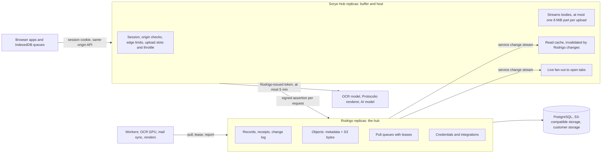

# Hub as buffer, Rodrigo as hub: alignment status

This page tracks the move to the target architecture decided by the product owner: **Sorye Hub is a buffer and the micro-frontend host; Rodrigo owns every record, credential, external integration, durable event, job queue and work routing.** Traffic load balancing is an ingress in front of each tier, not Rodrigo.

Rules for every slice: no fallback to Hub stores and no dual writes; workspace identity comes from the Hub session and is re-verified by Rodrigo from the signed assertion; apps never call Rodrigo or each other; a write is successful only after Rodrigo acknowledges it, and pending writes wait in the browser's IndexedDB queue.

## Slice status

Rodrigo reports each slice in `capabilities.alignment.slices` (`not_implemented`, `not_configured`, `ready`). Hub fails closed for a slice that is not `ready`.

| Slice | Status | Contract | Notes |
|---|---|---|---|
| 0. Contract and plumbing | Done | OpenAPI 2.2.0 | Streamed objects, service tokens, service change stream, Hub read cache |
| 1. Workspace identity | Done | OpenAPI 2.3.0 | Users, workspaces, membership, plan and enabled apps in Rodrigo; membership re-verified per request |
| 2. Storage | Pending | | |
| 3. Events, handoffs, Relay delivery, notifications | Pending | | |
| 4. Jobs | Pending | | |
| 5. Mail | Pending | | |
| 6. Remaining domains | Pending | | |
| 7. Compute services | Pending | | |
| 8. Removal and infrastructure | Pending | | |

## Slice 0: contract and plumbing

### Streamed objects (`/v2/objects/`)

Immutable objects up to 2 GiB, identified by caller-chosen UUIDs that are never reused (not even after deletion). The assertion's `app:<purpose>` scope (`files`, `tasks`, `messenger`, `ocr`, `mail`, `site`, `forms`, `protocolio`, `relay`) owns the object: another app scope cannot read it, another workspace gets 404.

1. `POST /v2/objects/uploads` with `If-None-Match: *` and `{objectId, purpose, size, sha256, contentType}` opens a session (201). Repeating it with identical metadata resumes the session (200) and lists stored parts. A ready object answers 412 `object_exists`; other metadata or a failed or deleted id answers 409 `object_id_reused`.
2. `PUT /v2/objects/uploads/{uploadId}/parts/{n}` streams one 8 MiB part (the last may be shorter). The signed `bodySha256` claim is the part's SHA-256; Rodrigo hashes while it receives and refuses a mismatch with 422 `checksum_mismatch`. Parts are idempotent and retried by Hub on 429, 503 and transport errors.
3. `POST /v2/objects/uploads/{uploadId}/complete` assembles the parts, reads the stored object back, and compares size and SHA-256 with the session. A mismatch deletes the bytes and answers 422 `integrity_failed`. Success marks the object ready and appends a change row in the same transaction. Repeating after success returns the same metadata.
4. `GET /v2/objects/{id}` streams the bytes (single `Range` supported, `ETag` is the SHA-256); `GET .../meta`; `DELETE` tombstones then removes the bytes.

Metadata, sessions and parts live in PostgreSQL (`008_alignment_plumbing.sql`); bytes in the S3 registration named by `objects` in Rodrigo's provider file, under `workspaces/<workspace>/files/<id>`. Expired sessions (6 hours) are aborted by a housekeeping task. At most eight parts are held in memory per Rodrigo replica; further parts queue for up to 10 seconds.

Hub client: `apps/hub/lib/rodrigo/objects-client.ts`. Hub holds one part per upload and verifies the browser's SHA-256 over the received bytes before the last part is sent.

### Service tokens (`/v2/service-tokens`)

Before Hub calls a compute service for a user, it asks Rodrigo for a token: `{service: ocr|protocolio|ai, operation, appId, ttlSeconds ≤ 300}`. The token is an EdDSA JWT (`iss rodrigo`, `aud sorye-<service>`, user, workspace, operation, expiry) signed with Rodrigo's service-token key (`RODRIGO_SERVICE_TOKEN_KEYS_FILE`). Services verify it with `GET /v2/service-tokens/keys` (public, no secrets). `appId` must be signed by Hub and allowed for the service. At most 240 tokens per workspace per minute per replica (429 `workspace_rate_limited`). Hub client: `apps/hub/lib/rodrigo/service-tokens.ts`.

### Service change stream (`/v2/service/changes/`)

Every v2 action commit and object completion or deletion appends `{workspaceId, appId, resourceType, resourceId, revision, deleted}` to `rodrigo_changes` in the same transaction. Hub subscribes once per replica with the reserved assertion workspace `rodrigo-service` and actor `service:hub` (refused everywhere else). Changes are ordered by committing transaction and served only once every older transaction has finished, so a cursor never skips a later commit. Delivery is at-least-once within 72 hours of retention; an expired cursor answers 410 `cursor_expired` and Hub restarts from the head and drops its caches. Hub client: `apps/hub/lib/rodrigo/changes.ts`.

### Hub read cache

`apps/hub/lib/rodrigo/read-cache.ts`: bounded (5,000 entries, 64 MiB), 15-second TTL, keyed by workspace, app and resource type, and dropped by any change to that type in that workspace. It is bypassed whenever the change stream is not healthy, and a read that started before an invalidation is not stored. It is never a write path.

## Slice 1: workspace identity

Rodrigo owns users, workspaces, membership, plan and enabled apps (`009_identity.sql`). Hub keeps only the browser login (Auth.js) and the administrator e-mail list.

- **Session resolution.** `ensureHubUser` calls `resolveLoginSession` (`apps/hub/lib/rodrigo/identity-client.ts`): `GET /v2/identity/session/active` on the reserved `rodrigo-identity` grant, signed with the verified login subject. When the user is unknown or the profile changed, `PUT /v2/identity/profile` creates the user with a free Personal workspace or updates the profile. Concurrent first sign-ins converge on one record. An e-mail held by another login is refused (`email_in_use`).
- **Writes.** Switching the active workspace, creating a team (plan-checked), and changing name, enabled apps and connections (plan caps apply only to growth; optional revision check) are Rodrigo operations. Administrator plan assignment trims to the new limits; a billing tier change keeps everything and Hub reports extras as locked. Platform routes (`/v2/platform/identity/`) serve the administration console, billing and plan schedules as `service:hub` or a verified administrator.
- **Cache.** Hub caches resolved sessions for 15 seconds per user and workspace. Every identity write appends a change row per affected user's session in its transaction; the change stream drops the entry, and the cache is bypassed while the stream is unhealthy.
- **Re-verification.** With the provider option `enforce_membership`, Rodrigo checks on every workspace-scoped request that the signed subject is a member of the signed workspace (403 `not_member`), through a 30-second per-replica cache. Reserved grants and `service:*` actors are exempt.
- **No migration.** Hub's old identity records (`.data/store.json` or the Hub PostgreSQL users/workspaces tables) are no longer read. After cutover each person gets a new Personal workspace on first sign-in, so records Rodrigo holds under old workspace ids are unreachable (product-owner decision B). The legacy v1 document export/import command (`lib/tools/migrate-rodrigo-document.ts`) was removed for the same reason.

| Measure (slice 1, same local setup) | Result |
|---|---|
| Session read, uncached (6 indexed queries, debug build) | p50 12.0 ms, p95 12.8 ms |
| Session read, cached | under 0.01 ms |
| Plan change elsewhere visible in Hub sessions | about 200 ms |
| Database stopped | sign-in fails closed; recovers without restart |
| 12 concurrent first sign-ins | one user, one workspace |

Tests: `apps/hub/test/rodrigo-identity.test.ts`, Rodrigo `identity` unit tests.

### Measurements (slice 0, local: debug Rodrigo build, PostgreSQL 16 and RustFS in Docker on the same Windows host)

| Measure | Result |
|---|---|
| 64 MiB upload through the Hub client (8 parts, read-back verification) | 2.7 s (23.5 MiB/s) |
| 64 MiB streamed download | 0.23 s |
| Hub memory during the 64 MiB upload | peak Buffer growth 23.9 MiB, RSS growth 24.1 MiB (no whole-file buffering) |
| 16 concurrent 2 MiB uploads | p50 473 ms, p95 575 ms, no failures (before the fix: 8 of 16 failed with connection resets) |
| Commit to Hub change delivery | at most 183 ms |
| Storage stopped | upload refused with 503, nothing acknowledged; recovers after restart |
| Database stopped | object routes 503; recover without restart |
| Rodrigo restarted mid-upload | session resumes, only the missing part is sent |

Tests: `apps/hub/test/rodrigo-alignment.test.ts` (real binary; opt in with `RODRIGO_TEST_POSTGRES_URL`, `RODRIGO_TEST_S3_ENDPOINT`, and for failure injection `RODRIGO_TEST_S3_CONTAINER`, `RODRIGO_TEST_POSTGRES_CONTAINER`), Rodrigo `tests/alignment.rs`.
