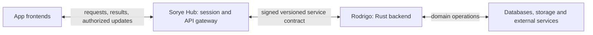

# Apps, Sorye Hub and Rodrigo

**Implementation status:** signed v2 actions cover typed PostgreSQL-backed resource families; live Hub integrations include Tasks, Notes, Calendar, Canvas, Site editing and published public reads, Storefront products and enquiry orders, a workspace profile slice, and Messenger text/channel resources. Browser writes use scoped IndexedDB queues, and legacy writers are disabled for those slices. Most Hub API/store/worker mutations remain uncovered, as do attachments/blobs, external jobs, event delivery, Storefront status transitions, and workspace/team policy. Task description photos are an exception only as Hub Drive files in the Tasks section (`sourceAppId: tasks`), referenced by `driveFileId` on the Rodrigo task board. That does not move Drive bytes into Rodrigo. This remains pre-production and no-migration; existing Hub-owned data may become unavailable. See [the switching runbook](RODRIGO-DATABASE-SWITCHING-RUNBOOK.md).

The target contract for all app data, action batches, durable acknowledgements, retries, security, and staged database switching is [RODRIGO-DATA-CONTRACT.md](RODRIGO-DATA-CONTRACT.md). Read it alongside the current implementation notes below.

Sorye Hub is the layer between app frontends and the Rodrigo Rust backend. Hub has two explicit interfaces: it communicates with apps through the browser platform/API contract, and with Rodrigo through a signed, versioned server-to-server contract. Separate app images do not remove either interface.

## Intended ownership

| Component | Responsibility |
|---|---|
| App frontend | App UI, private UI state, user actions and rendering authorized results. |
| App subdomain gateway | Serve that app's remote assets when applicable; proxy browser pages and API traffic to Hub. No domain records or business logic. |
| Sorye Hub | UI host and app integration, browser sessions, authorization at the browser boundary, input validation, typed forwarding to Rodrigo, and delivery of responses and updates to apps. |
| Rodrigo Rust backend | Domain operations, backend fetching and service integrations, durable event spine, jobs, coordination, and database/cache/blob access behind explicit service contracts. |

The browser platform kernel remains a Hub/app UI integration mechanism. It is distinct from Rodrigo's intended durable event spine. Private frontend state does not move into Rodrigo merely because backend services do.

This diagram is the target boundary. It does not assert that all of these backend paths are implemented today.

## Request and event flows

1. An app calls Hub through its same-origin API or platform client. A subdomain gateway forwards the request to Hub.
2. Hub verifies the browser session and app access. User and workspace claims come from trusted server-side identity resolution, never an arbitrary browser workspace ID.
3. Hub validates the request and calls the matching Rodrigo operation with a short-lived signed assertion. Rodrigo independently verifies the signature, scope and workspace authority.
4. Rodrigo executes the domain operation through its service interfaces and returns a typed result or explicit failure. Hub returns the authorized result to the app.
5. For the target event flow, app intents pass through Hub to Rodrigo's durable event spine. Authorized event results, handoffs and notifications return through Hub to the consuming apps. Apps do not call one another or Rodrigo directly. Polling, streaming and delivery guarantees must be defined by the migration contracts; this document does not introduce a new transport.

Backend fetching means server-side data/service operations. Browsers still fetch frontend assets and call Hub; it does not mean routing every browser network request through Rust.

## Current implementation and missing migration

Today Hub still implements most domain storage, event publication, handoffs, notifications and job paths. Tasks, Notes, Calendar, Canvas, Site editing and published public reads, Storefront products and enquiry orders, workspace profile name/read paths, and Messenger text/channel resources use authenticated Rodrigo v2 routes; browser mutations use app-owned IndexedDB queues. Their old resource mutation endpoints are disabled. `/api/backend/actions/batch` validates typed payloads, checks app access, role gates and a user/workspace-bound queue scope, then signs the server-to-server request. Messenger uses a separate channel-authorized timeline route; generic resource routes reject Messenger reads. Published Site reads use a reserved service assertion and a slug index. `apps/hub/app/api/events/route.ts` still calls Hub's event publisher. Most other catalog apps, blobs, external jobs, workspace app/team policy, Messenger attachments/read receipts, and Storefront status transitions remain migration responsibilities, not the desired permanent ownership.

The live Hub-to-Rodrigo integrations are `/api/backend/capabilities` and platform-admin-only `/api/backend/topology`. Tasks and Calendar also support explicit per-workspace forwarding through a verified RODRIGO_DOCUMENT_OWNERS entry. Unmapped workspaces and Notes retain Hub ownership. The migration command exports, imports and verifies one document at a time; it never activates ownership itself. It uses signed requests and validates the versioned response. Rodrigo now implements optional PostgreSQL/MySQL/MongoDB document stores, Redis cache and S3-compatible storage. Its document writes commit durable change records with the owner and support resumable SSE. Unconfigured adapters report `not_configured`; readiness reflects configuration and dependency probes. Configuring `RODRIGO_BASE_URL` does not migrate app traffic or events. Generic jobs, arbitrary event publication and identity bootstrap remain separate work.

Hub's `.data` volume protects records still owned by the current implementation during image replacement. Remove a storage path or credential only after its domain has moved successfully. Hub-native UI also remains in Hub; separate gateway images do not extract it. Protocolio's renderer and MongoDB remain a separate service boundary until explicitly migrated.

## Completing the boundary

- Define identity bootstrap first: Hub verifies the login subject; a signed session-resolution contract lets Rodrigo resolve membership and workspace authority without trusting client input.
- Extend Rodrigo's authoritative `contracts/` and update Sorye's reviewed contract snapshot and DTOs together. Keep Rodrigo source and deployment in its independent repository.
- Implement each domain and the event spine behind bounded, observable service interfaces. Define ordering, retries, idempotency, acknowledgements and recovery before claiming durable event delivery.
- Migrate one authoritative writer at a time. Prove authorization, stale-write conflicts, equivalent data, dependency failures and restart recovery before switching Hub to forwarding. Do not silently fall back to Hub stores or dual-write when Rodrigo fails.
- Remove obsolete Hub domain implementations and credentials after verified cutover. Keep browser integration and session handling in Hub.

## Release boundary

Apps, Hub and Rodrigo are separate release units. Sorye's Forgejo workflow builds Hub and app images; it does not build or release Rodrigo. Rodrigo has its own repository and release process. Dockyard manages their independently registered image digests.

Record the compatible Hub and Rodrigo digests and contract version for a release. For an additive contract change, deploy a backward-compatible Rodrigo first, then the Hub caller, then any frontend that requires the new API. Verify the complete app-to-Hub-to-Rodrigo path. Breaking changes require an explicit migration and rollback plan; image rollback does not undo data migrations. Do not remove the previous contract while a deployed caller still needs it.

See [Rodrigo integration](RODRIGO.md) for the live contract and migration requirements, [the behavior map](APP-BEHAVIOR-TREE.md) for current flows, and [the deployment guide](../deploy/README.md) for app image promotion.
