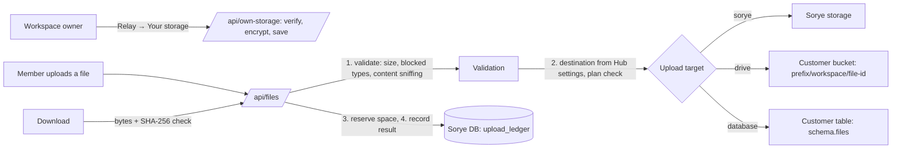

# Your own storage (Relay → Your storage)

A workspace on **Pro or Enterprise** can keep its uploaded files on storage it owns instead of Sorye's: an **S3-compatible drive** (Amazon S3, Cloudflare R2, Backblaze B2, Wasabi, MinIO, SeaweedFS, …) or a **PostgreSQL database**. Sorye then redirects every new Drive upload (Drive, Tasks photos, OCR PDFs) there and keeps only a record of it in its own database.



## What the owner sees

Relay has a **Your storage** tab with four parts:

1. **Where new uploads go**: Sorye storage (default), Your drive, or Your database. A destination can be chosen only after it is connected; switching re-tests the connection first.
2. **Connect your drive** and 3. **Connect your database**, each with
   - **What we need**: every field with what it is, where to find it and an example (below);
   - **Minimum permissions**: an IAM policy or SQL, filled in from what the owner typed, with a Copy button;
   - **How Sorye uses it**;
   - the form, or, once connected, the status, last check, **used / free / limit / file count**, and Check connection, Change limit, Replace credentials, Disconnect.
4. **Upload record**: the latest uploads with time, file, size, destination, status and SHA-256.

Members see the settings read-only; only the owner sees the upload record.

### Space

S3-compatible storage and PostgreSQL have no fixed total size, so Sorye cannot read a real "total" or "free":

- **Used** is exact: the sum of what Sorye stored there and has not deleted, plus uploads in progress.
- **Limit** is what the owner allows Sorye to use (1 GB – 100 TB).
- **Free** is limit − used.
- For a database, the **table size on the server** (`pg_total_relation_size`, including indexes and TOAST) is also shown.

An upload that would exceed the limit is refused. The check and the reservation happen under one lock (JSON file lock, or `SELECT … FOR UPDATE` on the settings row in Postgres), so parallel uploads cannot overshoot.

## What we need

### Connect your drive

| Field | Required | Notes |
|-------|----------|-------|
| Provider | yes | `aws-s3`, `cloudflare-r2` or `s3-compatible` |
| Bucket name | yes | Must exist. 3–63 characters, lower-case S3 rules |
| Region | AWS, S3-compatible | AWS region (`eu-central-1`); S3-compatible default `us-east-1` |
| Cloudflare account ID | R2 | 32 hex characters; endpoint is built from it |
| Endpoint | S3-compatible | HTTPS origin only: no path, query, user info. AWS and R2 endpoints are fixed by Sorye |
| Path-style addresses | S3-compatible | On by default |
| Folder | no | Default `sorye/`; Sorye writes only under it |
| Access key ID, Secret access key | yes | Write-only; shown never again |
| Storage limit (GB) | yes | 1 – 102 400 |

Minimum AWS policy (other providers: a key limited to one bucket):

```json
{ "Version": "2012-10-17", "Statement": [
  { "Effect": "Allow", "Action": ["s3:ListBucket"], "Resource": "arn:aws:s3:::BUCKET" },
  { "Effect": "Allow", "Action": ["s3:PutObject", "s3:GetObject", "s3:DeleteObject"], "Resource": "arn:aws:s3:::BUCKET/sorye/*" } ] }
```

### Connect your database

| Field | Required | Notes |
|-------|----------|-------|
| Host | yes | Public DNS name or IP; private addresses are refused |
| Port | no | Default 5432 |
| Database, User | yes | Use a dedicated role, never an administrator |
| Password | yes | Write-only |
| Schema | no | Default `sorye_uploads`; `public`, `pg_*`, `information_schema` are refused |
| Encryption | yes | `verify` (default: TLS + certificate and host-name check) or `encrypt` (TLS without certificate check) |
| CA certificate | no | PEM, ≤ 16 KB, for a private CA (for example Amazon RDS) with `verify` |
| Storage limit (GB) | yes | 1 – 102 400 |

Least-privilege setup for the database administrator:

```sql
CREATE ROLE sorye_uploader LOGIN PASSWORD '…';
GRANT CONNECT ON DATABASE acme TO sorye_uploader;
CREATE SCHEMA sorye_uploads AUTHORIZATION sorye_uploader;
```

Sorye then creates `sorye_uploads.files (id uuid PK, workspace_id, file_name, mime, size, sha256, content bytea, created_at, CHECK (octet_length(content) = size))`. It never runs `CREATE SCHEMA` when the schema exists (that would need database-level CREATE).

## Security model

| Threat | Defence |
|--------|---------|
| Another member changes where the workspace's files go | Every write route requires the workspace **owner** (from the server session) and an eligible plan. The workspace id never comes from the request; extra fields are rejected |
| SSRF: making the Hub reach internal services or cloud metadata | Host names must be valid DNS names or IPs. Every address they resolve to must be public (RFC 6890 ranges, IPv6 ULA/link-local, and IPv4 embedded in mapped, NAT64, 6to4 and Teredo addresses are refused). Drive requests use an HTTPS agent whose `lookup` re-checks **every socket**; database connections are **pinned** to the checked address with TLS verified against the typed host name, so DNS rebinding cannot redirect them |
| Probing networks through error messages | Failures are mapped to fixed codes (`auth_failed`, `unreachable`, …); provider and driver messages never leave the server |
| Plaintext credentials or data in transit | HTTPS for drives (TLS ≥ 1.2); TLS always for databases. `disable` exists only in development |
| Credential theft from Sorye's database | AES-256-GCM with `STORAGE_SECRET_KEY`, and the workspace and field as associated data, so a ciphertext copied to another workspace does not decrypt. Credentials are never returned by any API |
| Path traversal / overwriting other objects | Object keys are `prefix + workspaceId + "/" + fileId`, built by the server from validated ids; prefixes forbid `..`, `.`, leading `/` and `//` |
| SQL injection | Identifiers (schema) match `^[a-z_][a-z0-9_]{0,62}$`; all values are bound parameters |
| Malicious uploads | Same policy as Sorye storage: 64 MB cap, blocked extensions, executable signatures refused, content sniffed and the MIME type decided by the server |
| Files changed on the customer's side (for example replaced with HTML/script) | Each file's size and SHA-256 are recorded at upload; bytes read back are checked before anything is sent. A mismatch returns 502 and is not served |
| Silent data leaving the customer's control | **Fail closed**: if the chosen storage is unreachable or the plan lapses, the upload is refused and nothing is written to Sorye storage |
| Orphaned files | A connection cannot be removed while it is the upload target or still holds files; it cannot be pointed at a different bucket/prefix/database while files are stored there. Deleting a file deletes the customer copy first and keeps the Drive record if that fails |
| Abuse and brute force | Per-owner rate limits on every write (connect 8 / 10 min, others 20 / 10 min); request bodies ≤ 24 KB |

## Upload record (Sorye's own database)

Every upload gets one `upload_ledger` row, whatever the destination, including rejected ones:

`id, workspace_id, file_id, user_id, target (sorye | drive | database), location, display_name, mime, size, sha256, source_app_id, status (pending | stored | failed | rejected | deleted), error_code, created_at, completed_at`

Settings live in `workspace_upload_storage` (target, non-secret settings as JSON, encrypted secrets). Both tables are in `packages/db/src/schema.ts`; with `STORE_DRIVER=json` the same data is in `.data/own-storage.json`. Apply the schema with `pnpm db:generate` and a reviewed migration (or `pnpm db:push` locally).

## Operating it

- `STORAGE_SECRET_KEY` (32+ characters) must be set, or the tab says credentials cannot be stored. Rotating it makes saved credentials unreadable: owners must replace them.
- `OWN_STORAGE_DEV_INSECURE=true` (development and tests only; `env.ts` refuses it in production) allows private hosts, plain HTTP endpoints and `disable` TLS so local containers can stand in for customer storage.
- The workspace **app-data database** setting (`/api/workspace/storage`, Canvas, Messenger and OCR records) now follows the same rules: owner only, Pro/Enterprise, public-address check with a pinned address, TLS required (`sslmode=disable` refused; `verify-full`/`verify-ca` verify the certificate), fixed error messages and a rate limit.

## Landing page

The Relay landing page (`/learn/relay`) describes sending app updates to Messenger and websites; that description remains accurate. Own storage is a Pro/Enterprise setting inside Relay and is presented on `/pricing` and in Relay itself, not as one of Relay's three introduction steps.

## Testing locally

1. Start an S3-compatible server and a PostgreSQL on the sandbox network (MinIO no longer publishes public images; SeaweedFS works):
   `docker run -d --name sorye-ostest-s3 --network sorye-sandbox_default -v <s3.json>:/etc/seaweed/s3.json:ro chrislusf/seaweedfs server -s3 -s3.config=/etc/seaweed/s3.json -dir=/data`
   `docker run -d --name sorye-ostest-pg --network sorye-sandbox_default -e POSTGRES_USER=acme_admin -e POSTGRES_PASSWORD=… -e POSTGRES_DB=acme postgres:16-alpine`
2. Create the bucket (`echo "s3.bucket.create -name acme-sorye-files" | docker exec -i sorye-ostest-s3 weed shell`) and run the least-privilege SQL above.
3. With `OWN_STORAGE_DEV_INSECURE=true` and `STORAGE_SECRET_KEY` set on the Hub, open Relay → Your storage: drive endpoint `http://sorye-ostest-s3:8333`, path-style on; database host `sorye-ostest-pg`, Encryption "No encryption (development only)".
4. Unit tests: `pnpm --filter @sorye/hub test:own-storage`.
