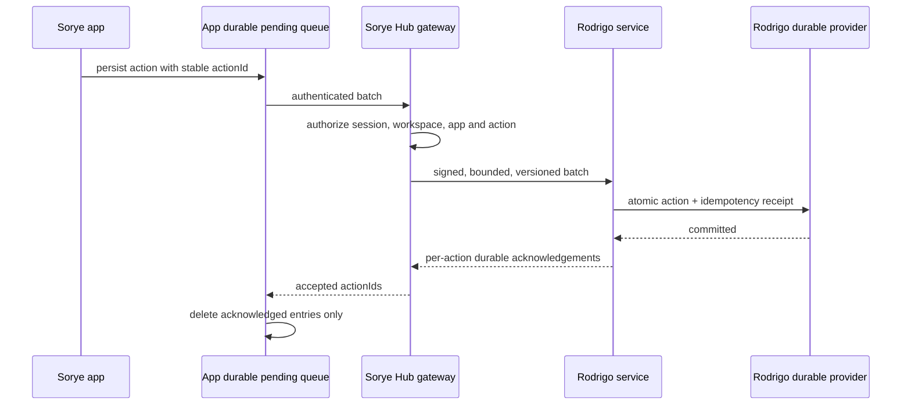

# Sorye Hub ↔ Rodrigo durable data contract

**Status: partially implemented.** Rodrigo implements signed v2 actions, PostgreSQL-backed atomic receipts, typed app/resource families, single-resource reads, bounded collection pages, actor attribution, a channel-authorized Messenger timeline, and a reserved-grant published Site read. Tasks, Notes, Calendar, Canvas, Site editing and published public reads, Storefront products and enquiry orders, workspace profile name/read paths, and Messenger text/channels now use Hub v2 routes; browser mutations persist in app-owned IndexedDB queues. Legacy Hub writers are disabled for these slices. Most remaining catalog apps, workspace app-access/team policy, Hub-native state, blobs, external jobs, event delivery, Messenger attachments/read receipts, and Storefront order status transitions remain uncovered. Do not describe the global boundary as complete until each persisted action is migrated and verified.

### Implemented app and resource slices

| App | Resource / operations | Authorization | Payload / storage | Read and concurrency | Side effects / completion |
|---|---|---|---|---|---|
| Tasks | `taskBoard/main`, `create`, `update` (delete prohibited) | Hub derives actor and workspace from `ensureHubUser`; requires membership and enabled `tasks`; Rodrigo verifies signed app/action scopes | Payload v1 has exact `statuses` and `tasks` arrays with bounded typed fields. A task may include optional `driveFileId`, a Hub Drive object id. PostgreSQL stores that id with the board; the photo bytes stay in Hub Drive under the Tasks section (`sourceAppId: tasks`). Rodrigo does not store the blob. Resource row and `(workspaceId, actionId)` receipt commit atomically | `GET /api/tasks` reads Rodrigo snapshot/revision; create requires absence; update requires expected revision; stale update returns conflict | Browser queue is IndexedDB partitioned by opaque server-derived user/workspace hash. Clear only on committed/duplicate. Outage leaves action pending; UI displays counts and Resend. No external effects. Existing Hub Tasks writes return 410. Legacy localStorage is not imported. |

Tasks' board-as-aggregate means a concurrent board edit conflicts at the board revision; the client does not merge or overwrite automatically. When Rodrigo cannot be read at startup, the UI may render the latest locally queued board as visibly unconfirmed; it is not treated as an authoritative read and the action remains queued.

| App | Resource / operations | Authorization | Payload / storage | Read and concurrency | Side effects / completion |
|---|---|---|---|---|---|
| Notes | `note/{id}`, create/update/delete | Hub derives actor/workspace, checks membership and enabled Notes access; signed action scopes are verified by Rodrigo | Typed note payload v1; PostgreSQL resource and receipt are atomic | Collection read through Hub; each note has a revision; stale updates remain conflicts | Queue is IndexedDB partitioned by opaque server-derived user/workspace scope. Pending/failed/conflict/rejected states and Resend are shown. Hub legacy mutation returns 410. Conflict drafts remain a convenience copy. |
| Calendar | `event/{id}`, create/update/delete | Hub derives actor/workspace, checks membership and enabled Calendar access; signed action scopes are verified by Rodrigo | Typed date/time event payload v1; PostgreSQL resource and receipt are atomic | Collection read through Hub; per-event revision; stale updates remain conflicts | Queue is IndexedDB scoped to user/workspace; pending/failed/conflict/rejected states and Resend are shown. Hub legacy mutation returns 410. Event notifications still use the separate Hub event path and are not covered by this action migration. |
| Canvas | `board/{id}`, create/update/delete | Hub checks current membership, enabled Canvas app and queue scope | Typed board envelope v1; PostgreSQL resource and receipt are atomic; nested document validation remains incomplete | Rodrigo revisions; single/collection reads go through Hub; conflicts require reload/reconciliation | IndexedDB queue and Resend are active; legacy Hub board writes are disabled. Presence and board-change SSE remain Hub realtime paths. |
| Site editor | `page/{workspaceId}`, create/update | Hub checks membership, enabled Site app, owner role and queue scope | Typed page payload v1; slug is a public path segment; blocks are bounded typed entries; PostgreSQL resource, receipt, and slug index commit atomically | Singleton resource read via Hub; revision conflicts are explicit. Anonymous `GET /v2/public/sites/{slug}` uses a reserved Hub service assertion, not a browser-selected workspace. Unknown or unpublished slugs are 404 | IndexedDB queue, Resend and reconciliation are active; legacy writer returns 410. Saving with Published on serves `/s/{slug}`. Saving with it off reserves the slug and returns 404. `sorye.site.published` is not emitted |
| Storefront products and enquiries | `product/{id}` create/update; `order/{id}` create | Products require the owner. Orders require a member. Hub rejects order updates and any customer name or email that is not the signed-in user | Product payload v1 keeps the card fields. Order payload v1 keeps the note and line items. PostgreSQL checks each line against the current active product price in the same transaction. `createdByUserId` is the verified actor, outside the payload | Product and order collection reads via Hub. Member order lists include only that actor's `requested` enquiries | IndexedDB queue and Resend are active for products and order creates. Legacy product and order writers return 410. Seed products are display defaults and cannot be ordered. Status changes (`accepted`, `cancelled`, `fulfilled`) are not a Hub workflow. `sorye.storefront.order_placed` is not emitted |
| Workspace profile | `settings/main`, create/update (name profile slice) | Hub requires authenticated workspace owner and queue scope | Typed name/locale/timezone settings v1; PostgreSQL resource and receipt are atomic | Singleton Rodrigo read; missing record returns deterministic default; provider failure is 503 | Name writes use IndexedDB. App enablement, connected-service configuration, and team membership remain Hub-owned policy writes. No current UI exposes the profile editor. |
| Messenger | `channel`, `message`, `reaction` create/update as supported; app currently uses channel/message writes | Hub derives actor/workspace, checks Messenger access and queue scope; Rodrigo verifies signed scopes, private/direct channel membership, and author-only message updates | Typed channel/message payloads; `createdByUserId` is added by Rodrigo from the verified actor, outside browser payload | Channel bootstrap filters private/direct channels for the current user; timeline route checks channel access and pages by `createdAt` plus resource ID | IndexedDB queue, Resend and logout flush are active; legacy Hub mutation route returns 410. Image/blob sends, read receipts, reaction UI, and `#events` delivery remain uncovered. No route-level Messenger tests yet. |

## Required guarantee

For every accepted product mutation, Hub returns success only after Rodrigo confirms that the mutation and its idempotency receipt have committed to the configured durable provider. A failed or unknown outcome is not success. Hub may retain a disposable cache or browser drafts, but neither is authoritative and neither may silently accept a mutation when Rodrigo is unavailable.

An app may batch transport for efficiency. Each action still has its own stable `actionId`, outcome, and acknowledgement. The application queue is persisted locally (IndexedDB where browser storage is available) until each action is acknowledged. In-memory queues, timer flushes, `pagehide`, logout hooks, and `sendBeacon` are opportunistic flush triggers, never durability guarantees. Hub logout gives loaded apps a bounded best-effort flush and reports unresolved queues; IndexedDB remains the recovery source after logout, tab close, or restart.



## Canonical batch contract

The authoritative OpenAPI definition is in Rodrigo's independent `contracts/` directory and the reviewed Sorye snapshot is `packages/types/contracts/rodrigo.openapi.json`. Rust validates the typed families advertised in that contract, including Site pages and Storefront orders. Live Hub routes are the table above, not every advertised family. A v2 change-feed API is still missing; existing v1 document snapshots and invalidation streams are separate contracts.

`POST /v2/actions/batch` accepts 1–100 actions, at most 256 KiB encoded JSON total, with a maximum age/retention policy documented by the deployment. The request is signed by Hub using the existing Ed25519 assertion scheme over the exact method, canonical path, body digest, audience, issue/expiry times, key id, and server-derived actor/workspace claims. The assertion lifetime remains at most 30 seconds. Production uses HTTPS, redirects are rejected, and the browser never receives Rodrigo credentials or assertions.

```json
{
  "actions": [
    {
      "actionId": "uuid",
      "appId": "notes",
      "resourceType": "note",
      "operation": "create",
      "resourceId": "client-generated-uuid",
      "occurredAt": "2026-11-09T13:00:00.000Z",
      "payloadVersion": 1,
      "payload": { "id": "client-generated-uuid", "title": "Title", "body": "Text", "updatedAt": "2026-11-09T13:00:00.000Z" }
    }
  ]
}
```

The body does not select its authoritative actor or workspace. Rodrigo derives them from the verified Hub assertion and verifies that each action's `appId`, resource type, and operation are in the asserted scopes. `occurredAt` is informational and never establishes ordering or authority. Updates and deletes include a positive `expectedRevision`; creates require resource absence and omit it. A stale revision returns `conflict`, never last-writer-wins. Payload schemas are app/action-specific, bounded, versioned, and reject unknown privileged fields.

The implemented endpoint requires `scope=actions:write`, plus signed `appScopes` and `actionScopes` claims. Supported scopes are limited to the currently implemented Tasks, Notes, and Calendar resource/operation combinations. Rodrigo replies with one result for every submitted `actionId`:

```json
{
  "contractVersion": "2",
  "results": [
    { "actionId": "uuid", "status": "committed", "commitId": "uuid", "revision": 1 }
  ]
}
```

Allowed statuses are `committed`, `duplicate` (same id and same canonical request digest; includes original commit/revision), `conflict`, and `rejected`. A repeated ID with a different digest is an explicit idempotency conflict and must never overwrite the original. A malformed whole batch is rejected before any action is committed. For per-action validation failures, valid actions may commit independently and every item receives an explicit result. Define transactional semantics per batch in OpenAPI; initial implementation should use per-action atomic commits so partial success is unambiguous.

`rejected/provider_unavailable` is retryable because the provider failure can occur after a database commit whose response was lost; retain and resend that exact action. Other `rejected` codes require correction. Conflicts require reconciliation and do not clear queue entries.

Rodrigo stores the PostgreSQL idempotency receipt in the same transaction as the current resource row mutation. The receipt key is `(workspace, actionId)` and records canonical digest, app/action identity, result, commit id, revision, and a ten-year retention horizon; current code does not prune receipts. PostgreSQL schema setup is required. Other configured providers do not own v2 action data. Provider ambiguous outcomes require the caller to keep the action pending and resend the exact same action.

## Retry, resend, and user experience

The app writes an action to IndexedDB before network submission. A row has `actionId`, app/resource/action keys, payload version, payload, creation time, attempt count, next attempt time, and status (`pending`, `sending`, `retry`, `conflict`, `rejected`). Payloads are encrypted only if a reviewed browser key-management design exists; otherwise minimize sensitive fields, enforce device access assumptions, and clear user-scoped queues on account change only after exporting or confirming their disposition. Never store session cookies or Rodrigo assertions in the queue.

Retry network errors, 429, and 5xx with bounded exponential backoff and jitter, honoring `Retry-After`. Do not retry 4xx validation/authorization failures without user correction. A timeout is an unknown outcome: retry the exact same `actionId` and canonical payload so Rodrigo returns the original receipt if it committed. Do not generate a new id on retry. Do not delete queue records based on a transport-level 2xx alone; delete only the individual actions with `committed` or `duplicate` outcomes.

The UI displays pending/failed state for each resource. **Resend** resubmits the identical action id and payload. Conflicts require fetching current state and an explicit merge or user choice; never silently overwrite. Logout flushes immediately, waits a bounded interval, and then reports the count still pending. Tab-close/window-close/pagehide trigger a best-effort flush; IndexedDB is the recovery source on the next authorized session. Background Sync may improve delivery where supported but is not a correctness dependency. Provide queue status and a safe way to inspect/retry pending actions without exposing other workspaces.

Reads go to Rodrigo as the source of truth. Hub may serve a bounded cache only when its revision is known; cache invalidation follows Rodrigo commit/change revisions. Cached or optimistic UI state is marked pending until the commit acknowledgement arrives and is reconciled to the canonical Rodrigo response.

## Security and authorization boundary

- Hub authenticates the browser session and derives user, active workspace, membership, app access, and role on the server. Ignore client-supplied workspace/actor/role/provider fields.
- Hub validates app enablement, domain schema, payload size, mention/member references, resource ownership, and operation scope before signing.
- Rodrigo independently verifies the Ed25519 signature, key id, issuer/audience, issue/expiry, exact-body digest, actor, workspace, app/action scopes, and replay/idempotency rules.
- Scope assertion claims to the minimum required operations. Separate read/write/delete/admin scopes. A client cannot request SQL, provider selection, arbitrary URL, storage path, or adapter configuration.
- Never expose the Rodrigo private key, provider URLs/credentials, signed assertions, raw payloads, or per-user labels in logs/metrics. Return generated request/commit IDs and machine-readable error codes.
- Admin/operator statistics use separate platform-admin authorization and aggregate metrics only. User/workspace ids and payload fields are excluded from Prometheus labels.
- Rate-limit by authenticated user/workspace and bounded batch size. Enforce per-user queue ceilings and backpressure; return a retryable overload response without acknowledging writes.

## Readiness, health, and observability

Separate process liveness from data readiness. `/health/live` means Rodrigo is running. `/health/ready` means it can accept writes for configured authoritative providers. `/v2/capabilities` reports supported contract versions, action families, provider configuration/readiness, limits, and idempotency retention; it contains no secrets. A write acknowledgement is the per-action proof of durable commit. A green health check alone never proves a particular action was saved.

Expose metrics for accepted/committed/duplicate/rejected actions by bounded app/action/status labels, batch size, durable commit latency, idempotency hits/conflicts, retry/unknown outcome rates, pending queue age (server-side only), provider errors, and outbox lag if an outbox is used. No user, workspace, resource, action UUID, email, or payload values become metric labels. Prometheus/Grafana access remains private or authenticated; Operator obtains a safe aggregate view through an admin-only Hub endpoint rather than exposing the metrics listener to browsers.

## App coverage and current gaps

Every catalog app that persists user or workspace state must use this contract. App IDs below come from `packages/types/src/apps.ts`; exact resource schemas and operations are a required Rodrigo contract inventory, not inferred here.

| App / area | Persisted operations to cover | Current status |
|---|---|---|
| Tasks | boards, columns/statuses, task create/update/move/delete, description photos | The `taskBoard` aggregate is live on v2. A description photo is a Hub Drive file in the Tasks section, referenced by `driveFileId`. That is not a Rodrigo blob and does not finish Drive. |
| Calendar | events create/update/delete | v2 supports typed event records only; current UI still writes whole documents through Hub; no cutover |
| Notes | notes create/update/delete | v2 supports typed note records; current UI still writes whole documents through Hub; no cutover |
| Messenger | channels, messages, reactions/attachments/mentions | Hub stores today; no matching Rodrigo domain contract |
| Mail | account metadata, drafts, outbound send intent, sync state | Hub stores today; secrets/provider credentials need a separate secret contract and must not enter generic action payloads |
| Files / Drive | metadata, versions, permissions, object references/deletes | Hub metadata today; bytes need Rodrigo blob/object contract; current blob size limit is not sufficient for general files |
| Relay | channels, routes, delivery config and delivery receipts | Hub stores today; secrets and external side effects require vault/reference and idempotent job contracts |
| Site | site/page/block edits and publish/unpublish | Page edits and anonymous published reads are live. Publish/unpublish is the page's `published` flag. Relay `sorye.site.published` delivery is not live |
| Storefront | products, orders, inventory and status transitions | Product edits and enquiry creates/reads are live. Price checks are transactional. Inventory reservations and status transitions are not a Hub workflow |
| Canvas | boards, objects and event mutations | Hub stores today; define revision/concurrency semantics before migration |
| OCR | analysis metadata, job state, patterns and result references | Hub stores some metadata; PDFs/transcripts require explicit sensitive-data retention and blob policy |
| Studio | app-specific persisted project state | Inventory actual API/storage before assigning schemas |
| Dashboard / Reports / Operator / Catalog | workspace preferences, notices/plans/admin actions where persisted | Separate user, workspace, and platform-admin scopes; do not treat telemetry as domain data |
| Protocolio | generated documents/configuration | Currently an independent service/DB boundary; coordinate its owner contract separately |
| SUSM / ESPM / Contact / Devtools | external iframe or presentation/tool state | Inventory ownership and persistence; do not proxy third-party credentials or claim coverage without an explicit contract |

The app inventory must be reconciled against every Hub API route and store call before declaring coverage. Browser-only preferences (language/theme/WebGPU settings) may remain on-device only when product policy explicitly classifies them as device preferences rather than account data.

## Existing contract and compatibility

Current v1 Rodrigo provides revisioned documents (`tasks|notes|calendar`), snapshots, document-change SSE, cache, blobs, capabilities, topology, and private Prometheus metrics. It has no generic durable action batch endpoint or general domain APIs for most Sorye apps. Existing document writes use expected revisions and no automatic mutation retry. Do not reinterpret the current document SSE invalidation stream as a general job queue. Add v2 alongside v1, update Rodrigo's authoritative OpenAPI and tests first, then the reviewed Sorye snapshot/DTOs/client. Keep v1 until every caller is migrated and rollback policy permits removal.

## Implementation acceptance criteria

1. Contract schemas, size limits, scopes, response codes, idempotency retention, ordering, and per-action commit semantics are specified in Rodrigo OpenAPI and Sorye's reviewed snapshot.
2. Contract tests cover valid/invalid auth, cross-workspace denial, disabled-app denial, oversized batches, same-key same-payload replay, same-key changed-payload rejection, partial batch outcomes, concurrent conflicts, provider outage, timeout after commit, restart recovery, and receipt retention.
3. Browser tests prove queued actions survive refresh/browser restart, only acknowledged rows clear, retry uses the same key, close/logout reports pending work, and a failed send exposes Resend.
4. Each app's routes are inventoried and migrated in bounded domain batches; no app writes authoritative product data to Hub stores after its cutover.
5. The Operator reports Hub gateway, Rodrigo API, provider readiness, last successful commit, pending/rejected aggregate counts, and timestamp separately. It never labels Hub's JSON/Next.js DB as Rodrigo's provider.
6. Verify restart, backup/restore, concurrency, outage recovery, and measured latency/load for each provider before production use.

## Observed live mutation surface (not yet Rodrigo-routed)

The route audit found live writes in `workspace/team`, `workspace/storage`, `workspace`, `calendar`, `tasks`, `admin/subscription`, `mcp/chat`, `protocolio/validate`, `notifications`, `admin/llm`, `storefront/products`, `storefront/orders`, `notes`, `notices`, `admin/llm/action`, `protocolio/generate`, `ocr/analyze`, `messenger`, `site`, `relay/storages/{id}`, `relay/storages/{id}/objects`, `ocr/active`, `mail`, `operator/notices`, `handoffs`, `operator/plan`, `mail/forward`, `ocr/analyses/query`, `ocr/analyses/{id}`, `ocr/analyses/{id}/continue`, `relay/storages`, `relay`, `events`, `embed/bootstrap`, `mail/draft`, `ocr/analyses/{id}/pattern`, `embed/widgets`, `canvas/boards`, `files`, `files/{id}`, `mail/accounts`, `canvas/boards/{boardId}`, `canvas/boards/{boardId}/events`, `jobs/{id}`, `files/{id}/open`, `llm/preferences`, `mail/accounts/{id}`, `mail/accounts/{id}/sync`, and `mail/accounts/{id}/send`. Verify each route's current backing store and whether the operation is product state, operational state, or a side effect before migrating it. Admin plans/notices and platform-admin settings require distinct scopes.

The client persistence audit found local writes in Tasks/Notes/Calendar conflict drafts and legacy cleanup; Relay configuration; Devtools logs; Protocolio template drafts and a token in localStorage; OCR comparison selection; Dashboard LLM/GPU preferences; and Hub app-usage dismissals. Classify each by account/workspace/device scope and sensitivity. Only explicitly device-only preferences and temporary UI state may remain local. Protocolio tokens and durable app drafts are not device preferences. SessionStorage usage includes OCR's last reading id, Storefront cart, and Hub pane/open-app state; those are navigational/UI state pending product ownership review. Migrated slices now persist pending actions in app-owned IndexedDB queues scoped by an opaque user/workspace hash. That does not cover the unmigrated apps in the audit.

Hub durable store families include JSON/PostgreSQL workspace core, workspace documents (Tasks/Notes/Calendar), Messenger/channel/messages, Canvas boards/events, Drive metadata plus a separate file/object store, Mail/accounts/drafts, Relay storage/objects, Site pages/publish state, Storefront products/orders, OCR analyses/patterns/jobs, events, notifications/handoffs, user preferences, operator settings/notices/plans, and LLM preferences/activity. Background workers include OCR processing/analysis and external mail/relay/provider calls. Job acceptance and SMTP/webhook enqueueing are not delivery acknowledgements. Each family still needs its own typed Rodrigo schema, transaction boundary, access scope, read/change API, concurrency rule, provider/object policy, and side-effect status contract before the Hub writer is removed.
