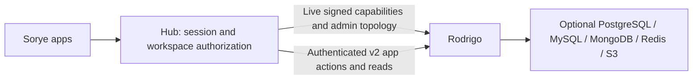

# Rodrigo backend integration

> **Current status: partially implemented.** Rodrigo v2 supports typed actions for all advertised app/resource families, signed single-resource and paged collection reads, actor attribution, channel-authorized Messenger timelines, and a reserved-grant published Site read. Tasks, Notes, Calendar, Canvas, Site editing and published public reads, Storefront products and enquiry orders, workspace profile name/read paths, and Messenger text/channel resources use the Hub v2 gateway; browser writes use scoped IndexedDB queues. Their legacy resource writers are disabled. Other catalog apps, Hub-native state, blobs, durable external jobs, event delivery, Messenger attachments/read receipts, and Storefront status transitions remain uncovered. See the [global data contract](RODRIGO-DATA-CONTRACT.md) and [no-migration switching runbook](RODRIGO-DATABASE-SWITCHING-RUNBOOK.md).

Rodrigo is a separately deployable backend in `D:\projects\rodrigo`. Its Rust source, provider adapters, images, monitoring and authoritative HTTP contract live there. Sorye contains the production signer, typed service client, shared DTOs and reviewed schema snapshot.

**Target global data contract:** [Sorye Hub ↔ Rodrigo durable data contract](RODRIGO-DATA-CONTRACT.md). It defines Rodrigo as the sole durable writer for every app, per-action durable acknowledgements, persistent client retry queues, security requirements, app coverage, current gaps, and acceptance criteria. It is a target, not a claim that existing routes already comply.

**Current ownership:** Apps reach Rodrigo only through authenticated Hub routes. The migrated resource slices are Rodrigo-owned. Most unmigrated app stores, events, identity, jobs, notifications and handoffs still use Hub stores. Protocolio's independent MongoDB is unchanged. Publishing/configuring Rodrigo does not move remaining data or events. See [the behavior map](APP-BEHAVIOR-TREE.md) and [ownership boundary](HUB-RODRIGO-BOUNDARY.md).

## Available Rodrigo contracts

Additive v2 provides `POST /v2/actions/batch`, scoped reads from `/v2/resources/{app}/{resourceType}/{resourceId}`, bounded keyset pages from `/v2/collections/{app}/{resourceType}/{limit}/{cursor}`, a channel-authorized Messenger timeline, and `GET /v2/public/sites/{slug}` for a reserved public-site grant. PostgreSQL commits each typed resource and idempotency receipt atomically. Site page writes also reserve the public slug in that transaction. Verified actor attribution is stored separately from app payloads. Receipts are retained for at least ten years; collection pages are individually statement-consistent but pagination is not a frozen multi-page snapshot. Durable external jobs and blob bytes still need separate scoped APIs.

HTTP v1 is retained. The reviewed 1.1 schema adds deletion, atomic snapshots, durable document SSE, Redis cache, named S3 blobs and topology. `packages/types/src/rodrigo.ts` includes the corresponding DTOs. The original four capability keys remain compatible; MySQL appears in `/v1/topology`. Unconfigured adapters report `not_configured`; `dataReady` requires all document kinds mapped and healthy configured dependencies.

- Documents: GET/PUT/DELETE `/v1/documents/{tasks|notes|calendar}`. PUT uses `{expectedRevision,payload}`; DELETE uses `{expectedRevision}`. Exactly one provider owns each kind. Conditional conflicts return 409; deletion keeps a revision tombstone.
- Snapshots: GET `/v1/snapshots/{kind}` returns `{revision,document}` atomically, including tombstone revision.
- Events: GET `/v1/events/{kind}/{after}` returns SSE `document.changed`, revision ID and `{revision,deleted}`. Changes commit with documents. Last 1,000 revisions per workspace/kind are retained. Delivery is at-least-once by replay within retention, with no global/cross-provider ordering or consumer acknowledgements.
- Cache: GET/PUT/DELETE `/v1/cache/{uuid}`, 64 KiB values and 1–3,600-second TTL; Redis is disposable, never durable ownership.
- Blobs: GET/PUT/DELETE `/v1/blobs/{configured-store}/{uuid}`, 256 KiB immutable objects. Update by creating a new UUID and conditionally replacing the owning reference. Never reuse deleted IDs. No transaction spans S3 and document metadata.

Unconfigured operations fail explicitly. There is no silent fallback or cross-database atomic transaction. Generic event publication, durable jobs, lease coordination, arbitrary SaaS connectors and multipart uploads are not implemented by these APIs.

## Signing and streaming

Hub must resolve user/workspace from its authenticated server session, validate app access and domain inputs, then call `signRodrigoRequest` with exact method/path/body bytes. Rodrigo verifies Ed25519 algorithm/key ID, issuer, audience, subject, workspace, scope, expiry, issue time and digest. Assertions expire within 30 seconds. The private key belongs only to Hub; public keys go to Rodrigo. Production requires HTTPS; redirects are rejected. Browser payloads cannot choose workspace, provider URL, SQL, Redis commands or paths.

Scopes: `capabilities:read`, `documents:read`, `documents:write`, `documents:delete`, `events:read`, `cache:read`, `cache:write`, `blobs:read`, `blobs:write`, `actions:read`, `actions:write`; v2 additionally requires signed `appScopes` and `actionScopes`. Errors preserve generated request IDs and machine codes. Never log assertions or payloads.

For future Hub event forwarding, reauthorize and freshly sign the cursor path on every reconnect. Do not forward browser `Last-Event-ID` upstream: Rodrigo rejects unsigned cursor headers. Streams last at most 25 seconds and never beyond assertion expiry, with five-second keepalives and 32 subscribers per replica. Deduplicate revisions and persist a cursor only after processing. On 410 or `stream.error: cursor_expired`, fetch a snapshot, replace local state, then resume after its revision. Disable ingress buffering and bound reconnect/backpressure at Hub. This document does not change the current browser event route.

Lost responses/timeouts can have committed outcomes. Read a snapshot and reconcile; never blindly retry mutations. `jti` is not a replay database. Cache/blob operations have no durable idempotency ledger.

## Migration and release

The pre-production v2 app cutover is no-migration: old Hub-owned records may become unavailable. Disable the Hub writer before a domain is routed to Rodrigo. The older v1 document migration command is a separate legacy mechanism and is not part of this cutover. Rollback must leave Rodrigo as the owner of already committed v2 records and must not reactivate stale Hub writes or reads. Follow [the database switching runbook](RODRIGO-DATABASE-SWITCHING-RUNBOOK.md).

Identity stays in `ensure-user.ts`/Hub stores until a separately reviewed signed session-resolution contract exists. Rodrigo's current requests require an already-authorized workspace. Never invent that workspace from browser input. Move one domain by quiescing writes, exporting/importing with revision reconciliation, switching the Hub route to the sole Rodrigo writer, proving parity/outage recovery, and then removing old credentials. Update both behavior maps with each live owner change. Do not add dual writes or a hidden Hub fallback.

Rodrigo supplies separate stable/canary Dockyard Compose registrations and a Forgejo publishing workflow. Both channels share the same owner map and stores; ingress controls weights. Schema migrations use expand/contract and are separate from app startup. Record compatible Hub/Rodrigo digests and schema version. Image rollback is not data rollback.

Prometheus/Grafana metrics and a redacting Alloy → Loki logging service live in Rodrigo's repository. Loki is separate from application databases, with seven-day configured retention; operational logging is best effort, not the durable event journal. See Rodrigo's `docs/DEPLOYMENT.md`, `docs/OPERATIONS.md` and `VERIFICATION.md` for details and measured limits.

## Setup and checks

For capability-only development, run `node scripts/setup.mjs` and `docker compose up -d --build --wait` in Rodrigo. API: loopback 8088; Grafana: loopback 13000, user `admin`, initial password in `.local/rodrigo/grafana-password.txt`. Provider tests have a separate isolated Compose stack; they do not touch customer data.

Set Hub's server-only `RODRIGO_BASE_URL`, `RODRIGO_KEY_ID`, `RODRIGO_PRIVATE_KEY_FILE`, then restart Hub. Local development allows loopback HTTP; production requires HTTPS. These settings do not automatically switch domain ownership.

Build Rodrigo with `cargo build --locked`, then run `pnpm rodrigo:test` in Sorye. The test launches the real executable using the production TypeScript signer and fresh keys. `RODRIGO_TEST_BINARY` selects a release artifact; default points to the sibling debug binary. Shared JSON snapshots and types must stay aligned with Rodrigo's `contracts/`. Run Hub TypeScript validation when those types change. Production capacity, real TLS topology, restore/failover and traffic splitting require deployment-specific evidence beyond local tests.

## Hub client coverage and cutover prerequisites

Hub routes import the server-only `apps/hub/lib/rodrigo/client.ts` entry point. The Node transport validates capabilities, topology, atomic snapshots (including deletion tombstones), conditional document writes and deletes. It preserves backend status, machine code and request ID in `RodrigoResponseError`, bounds requests to Rodrigo's 256 KiB limit, bounds responses, uses a three-second timeout and rejects redirects. It never retries mutations or falls back to another store. Callers must authorize app access and derive identity from the server session before invoking it.

The admin topology route reveals configured provider names and stream limits, never connection strings or credentials. It returns 401 without a session, 403 for non-admin users, and 503 for an unavailable or incompatible backend. Cache, blob and SSE forwarding are not implemented in Hub. Migrated app routes use signed v2 actions and reads; remaining Hub-owned data paths are listed in the data contract.

For the v2 app cutover, do not migrate existing Hub records. Missing Rodrigo resources return empty/default state, so warn that prior Hub data may be unavailable. Disable the legacy writer and follow the smoke, retry, access-denial, provider-outage, and rollback gates in the database switching runbook. The optional v1 document migration tooling is separate and must not be used as part of this no-migration cutover. Retain tombstone revisions when reading resources; resetting them to zero would permit stale writes. Identity bootstrap, general event publication, and external durable jobs remain uncovered.

Public app landing copy was reviewed for this internal integration change and remains accurate: no new customer-facing storage or event feature is advertised. With RODRIGO_TEST_POSTGRES_URL pointing to a disposable database, tests verify the export/import command, payload parity, 16 concurrent writes (one success, 15 conflicts), isolation, tombstones, restart recovery and service outages without fallback. These local checks do not establish production capacity or customer-record parity. See [the migration runbook](RODRIGO-MIGRATION.md).
