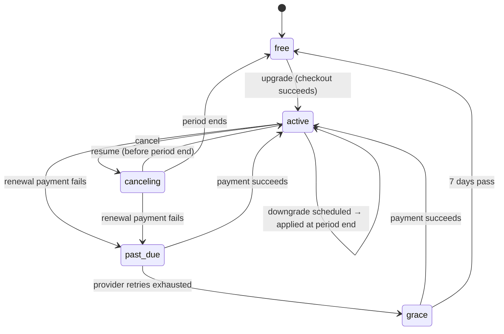

# Subscriptions

How a workspace moves between plans, how payments will drive that, and how to test every flow before a payment provider exists.

**Status (2026-11-11):** plans, the pricing page, the Plan & billing page, the state machine and a billing simulator are built. **No payment provider is connected**: in production the Plan & billing page shows plans and sends people to sales by email. Nothing charges a card.

## Plans

| Plan | Monthly | Yearly (2 months free) | Apps | Connections | Team workspaces | Team members | How to buy |
|------|--------:|------:|-----:|------------:|----------------:|-------------:|------------|
| Free | €0 | €0 | 2 | 1 | — | — | Default for every new user |
| Starter | €19 | €190 | 5 | 3 | — | — | Self-service |
| Pro | €49 | €490 | 12 | 10 | 1 | 5 | Self-service, highlighted |
| Enterprise | from €199 | from €1,990 | Unlimited | Unlimited | Unlimited | Unlimited | Contact sales |

- Prices are in EUR, excluding VAT (`PLAN_CURRENCY`, `YEARLY_MONTHS_CHARGED` in `packages/types/src/subscription.ts`).
- The App Library and other always-available apps never count toward the app limit.
- A plan belongs to a **workspace**. Only the workspace owner can change it; members see it read-only. The workspace always comes from the server session; requests never name one.

## Pages

| Route | Who | What |
|-------|-----|------|
| `/pricing` | Anyone | Plan comparison with a monthly/yearly switch. Free and paid plans continue on `/billing` (sign-in first); Enterprise opens an email to sales. |
| `/billing` | Signed-in members | Current plan and status, usage meters with locked counts, plan grid with upgrade/downgrade/interval actions, cancel and resume, payment-problem banners. In test mode, a simulator panel. |

Entry points: the plan badge in the Hub top bar, the "See plans" link when the app or connection limit is reached, and the pricing page.

## Billing states

| State | Limits that apply | What the member sees |
|-------|-------------------|----------------------|
| `free` | Free | Plan grid; "Start free" is the current plan |
| `active` | Paid tier | "Renews on …"; cancel button. A scheduled downgrade shows "Switches to … on …" with **Keep my plan** |
| `canceling` | Paid tier until `periodEndsAt` | Amber banner "Your plan ends on …"; **Keep my plan** |
| `past_due` | Paid tier | Red banner "The last payment failed"; **Update payment method** |
| `grace` | Paid tier until `graceEndsAt` (7 days) | Red banner with the date it drops to Free; **Update payment method** |

The transitions are pure functions in `apps/hub/lib/billing/transitions.ts`, covered by `apps/hub/test/billing.test.ts` (`pnpm --filter @sorye/hub test:billing`).

## Flows

1. **Upgrade** (Free → paid, or paid → higher paid): confirm dialog with the price → provider checkout → the new limits apply at once and a new period starts. With a provider, the change is applied only when the provider's signed webhook confirms payment, never from the browser redirect.
2. **Downgrade between paid plans:** confirm dialog with the date and a warning listing how many apps and connections would be locked → scheduled for the end of the paid period. **Keep my plan** removes the schedule.
3. **Switch to Free / cancel:** same as a downgrade to Free: paid limits stay until the period ends, then Free.
4. **Interval switch** (monthly ↔ yearly on the same plan): treated like an upgrade in the simulator (new period at once). A provider should credit the unused time (proration).
5. **Failed payment:** the provider retries; the workspace keeps its plan in `past_due`. When retries run out, `grace` starts with 7 days of paid limits; then Free.
6. **Enterprise:** "Talk to us" opens an email to sales. An administrator assigns the plan in the administration console (`/api/operator/plan`), as today.

## Going over a limit: keep and lock, never delete

When a workspace ends up over a limit (downgrade, cancellation, grace ending), **nothing is removed**. Items past the limit are *locked*, newest first, in selection order (`billingUsage()` in `packages/types/src/billing.ts`). Locked items should stay visible but not open until the member removes some or upgrades. The confirm dialogs warn about locks before any downgrade.

> **Gap — enforcement.** The Plan & billing page reports locked items, and the simulator changes tiers through `setWorkspaceTier()`, which never removes anything. The rest of the Hub (launcher, dock, connections) does not yet render locked items as locked. Before self-service downgrades go live, the launcher and connections panel must hide or disable `usage.apps.lockedIds` / `usage.connections.lockedIds`, and the server must refuse to open a locked app.
>
> **Gap — destructive admin paths.** `adminAssignSubscription` (`/dev`, `/api/admin/subscription`) and `assignWorkspacePlan` (administration console) still call `trimWorkspaceToPlanLimits`, which cuts the app and connection lists. Switch them to `setWorkspaceTier` when lock enforcement lands.

## API

All routes are same-origin (the middleware blocks cross-origin mutations), private and `no-store`.

| Method and path | Body | Result |
|-----------------|------|--------|
| `GET /api/billing` | — | `BillingSnapshot`: mode, owner flag, state, usage |
| `POST /api/billing` | `{ action: 'change', tierId, interval }` / `{ action: 'cancel' }` / `{ action: 'resume' }` | `{ ok: true, snapshot }` or `{ ok: false, code }`: `forbidden` 403 (not the owner), `unavailable` 503 (no provider), `invalid` 400, `no_change` 409 |
| `POST /api/billing/simulate` | `{ event }` | Test tunnel only; 404 unless the simulator is on |

Contract types: `packages/types/src/billing.ts`. Unknown fields, including any `workspaceId`, are rejected.

## Connecting a payment provider (next step)

The provider is not chosen. Whatever is chosen plugs in behind `apps/hub/lib/billing/service.ts`:

- **Checkout:** `POST /api/billing` with `change` returns a provider checkout URL instead of a snapshot for upgrades; the browser redirects there.
- **Self-service portal** for card, invoices and VAT IDs: the **Update payment method** button links there.
- **Webhooks** (new public route, signature-verified, idempotent by event id) map provider events onto the same transitions: payment succeeded → `payment_recovered` / renewal, payment failed → `payment_failed`, retries exhausted → `retries_exhausted`, subscription ended → `period_ended`.
- Store the provider customer and subscription ids on the workspace (today's `stripeCustomerId` / `stripeSubscriptionId` fields, or renamed provider-neutral fields) and the billing state in Postgres next to the workspace, not in a JSON file.
- Record every plan change in the audit log, as administrator plan changes already are.
- Decide on EU VAT handling: provider tax calculation, or a merchant of record that sells on Sorye's behalf.

## Testing every flow (billing simulator)

The simulator is the test tunnel. It replaces the payment provider so each state can be reached in seconds.

**Turn it on:** set `BILLING_SIMULATOR=true` for the Hub, with `NODE_ENV` not `production` (`env.ts` refuses to start production with it). The local sandbox (`.local/sandbox/compose.json`) has it on.

**What it does:** plan changes on `/billing` apply without payment, Enterprise included, and an amber **Test mode** banner plus a **Payment events** panel appear. State is kept per workspace in `.data/billing-simulator.json`; the tier is written to the workspace so the rest of the Hub enforces the new limits.

| To test | Steps on `/billing` |
|---------|---------------------|
| Upgrade | Free → **Upgrade to Pro** → Confirm |
| Yearly | Switch the toggle to Yearly → **Switch to yearly** |
| Scheduled downgrade | On Pro, **Switch to Starter** → banner "Switches to Starter on …" → **Period ends** applies it, or **Keep my plan** undoes it |
| Cancel and resume | **Cancel plan** → Ending banner → **Keep my plan**, or **Period ends** → Free |
| Locked items | Select more apps than Free allows on a paid plan, then cancel and press **Period ends**: the usage meters show the locked count; nothing is deleted |
| Failed payment and grace | **Payment fails** → **Retries run out** → **Grace period ends** (→ Free) or **Payment succeeds** / **Update payment method** (→ Active) |
| Member view | Open `/billing` in a team workspace you do not own: read-only with "Only the workspace owner can change the plan" |
| Without the simulator | Unset `BILLING_SIMULATOR`: every plan action opens a "not available yet" dialog with an email link |

To start over, pick the plan you want on `/billing` (any plan, including Enterprise, applies at once in test mode). To clear the simulator completely, stop the Hub, delete `.data/billing-simulator.json` and start it again; the Hub keeps the file in memory while it runs.
