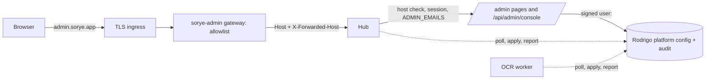

# Administration console runbook

The administration console runs at `https://admin.sorye.app`. It is part of Hub (`apps/hub/app/admin/**`), served through a dedicated admin gateway, and only platform administrators can use it. The customer Hub at `sorye.app` no longer contains any admin UI: `/admin` and the retired `/apps/operator` redirect to the admin host, and admin APIs answer 404 there.



## Decisions recorded

| Decision | Choice |
| --- | --- |
| Where the console lives | Hub-owned routes under `/admin`, reachable only on the admin host. No new app, no new frontend remote. |
| Customer `/admin` | 307 redirect to the admin origin. The redirect is not the protection: every admin page and API calls `adminAccess()` (host, real Auth.js session, platform-admin). |
| Operator app | Retired from the catalog and the customer Hub. Its components (`components/admin/operator-panels.tsx`), services (`lib/operator/**`) and APIs (`/api/operator*`) are reused by the console. |
| Who is an administrator | `ADMIN_EMAILS` (deployment input). Empty in production means nobody. Not editable from the console, so a stolen console session cannot add administrators. |
| Local admin host | `admin.localhost:<port>`. Browsers resolve `*.localhost` to loopback, so no hosts-file edit is needed. |
| Shared configuration owner | Rodrigo (PostgreSQL), namespace `shared-ai`, contract `platform` version 1 (`/v2/platform/**`, OpenAPI 2.1.0). |
| Settings precedence | Rodrigo revision, then the legacy `llm-control.json` settings (read-only now), then `OCR_LLM_*` environment. |
| Propagation | Pull. Hub and the OCR worker poll every 15 s (`PLATFORM_CONFIG_POLL_MS`), apply, cache the last good revision on disk, and report the applied revision. A write also refreshes the Hub immediately. |
| Pause, stop, cancel | Pause is configuration (`paused: true`); consumers refuse new AI requests after applying it, running requests finish. Stop is a Hub-process action available only while paused: it aborts this Hub's in-flight requests and unloads the Ollama model. There is no cancel of OCR worker jobs in progress. |
| Retries and conflicts | The console keeps one `changeId` per intended change and resends the same body on retry; Hub sends `correlationId = changeId` because Rodrigo digests the whole body. A stale `expectedRevision` (or `If-Match: "shared-ai-<n>"`) returns 409; the console then lists only the fields this administrator changed and can apply just those on top of the latest revision. |
| Hub-owned actions (plans, notices, stop) | Audited as a pending intent before the action and an outcome after. If the intent cannot be recorded, the action does not run (503 `audit_unavailable`). |

## Environment

Hub (both hosts are served by the same Hub deployment):

| Variable | Value | Notes |
| --- | --- | --- |
| `SORYE_PUBLIC_HOST` | `sorye.app` | Customer host. Default. |
| `SORYE_ADMIN_HOST` | `admin.sorye.app` | Default `admin.<public host>`. Must differ from the public host (startup refuses otherwise). |
| `SORYE_EXTRA_HOSTS` | optional | Extra customer aliases such as `www.sorye.app`. Catalog app subdomains (`<slug>.sorye.app`) are recognised automatically. Any other host, including the retired `operator.sorye.app`, gets 421 in production. |
| `ADMIN_EMAILS` | comma-separated | Required for anyone to administer. |
| `AUTH_URL` | **unset** | Production refuses it. Auth.js derives the origin per host so each host gets its own callback and host-only cookie. |
| `AUTH_DEV_BYPASS` | unset | Rejected in production. |
| `RODRIGO_BASE_URL`, `RODRIGO_KEY_ID`, `RODRIGO_PRIVATE_KEY_FILE` | as for v2 | Without them the console shows configuration and history as unavailable; nothing else breaks. |
| `PLATFORM_CONFIG_POLL_MS` | optional | 2000–300000, default 15000. Same variable for the OCR worker. |

OCR worker: the same Rodrigo variables as Hub (it signs as `service:ocr-worker`). It needs no admin variables.

Admin gateway (`deploy/dockyard-admin.compose.yml`): `SORYE_ADMIN_IMAGE` (immutable digest of the `-admin` image), `HUB_UPSTREAM` (internal Hub URL, for example `http://hub:3000`), optional `SORYE_ADMIN_PORT` (default 8130, bound to 127.0.0.1).

## DNS, TLS and ingress

1. DNS: an `A`/`AAAA` (or `CNAME`) record for `admin.sorye.app` pointing at the same ingress as `sorye.app`.
2. TLS: a certificate covering `admin.sorye.app` (its own certificate or a SAN; a `*.sorye.app` wildcard also covers it).
3. Ingress: route `admin.sorye.app` to the admin gateway, not straight to Hub. Pass the original `Host`. Example (Caddy):

   ```caddyfile
   admin.sorye.app {
       reverse_proxy 127.0.0.1:8130
   }
   ```

   Example (nginx in front of the gateway):

   ```nginx
   server {
       listen 443 ssl http2;
       server_name admin.sorye.app;
       ssl_certificate     /etc/ssl/admin.sorye.app/fullchain.pem;
       ssl_certificate_key /etc/ssl/admin.sorye.app/privkey.pem;
       client_max_body_size 64k;
       location / {
           proxy_pass http://127.0.0.1:8130;
           proxy_set_header Host $host;
       }
   }
   ```

   The gateway (`deploy/admin.nginx.conf`) forwards only `/admin/**`, `/api/admin/**`, `/api/operator/**`, `/api/auth/**`, `/login`, `/_next/**`, `/favicon.ico` and `/api/backend/{topology,capabilities}`; `/` redirects to `/admin`, everything else is 404. Hub enforces the same allowlist itself, so a misrouted ingress still cannot expose customer pages on the admin host.
4. Do not add `admin.sorye.app` to any app-gateway `server_name`, and do not proxy the admin host through the customer Hub gateway.
5. **Every proxy in front of Hub must overwrite `X-Forwarded-Host`.** Hub classifies a request by `X-Forwarded-Host` when present, so a proxy that passes a client-supplied value lets a request to `sorye.app` claim to be the admin host. The Sorye gateways set it from `$host`; Caddy overwrites it by default unless `trusted_proxies` is configured; plain nginx in front of Hub needs `proxy_set_header X-Forwarded-Host $host;`. Keep the Hub port bound to loopback or a private network (the Compose file binds `127.0.0.1`). Host-only cookies still keep an admin session off the customer host, so this is defence in depth, not the only control.

## Google OAuth callback

In the Google Cloud console, add this authorised redirect URI to the existing OAuth client (keep the customer one):

- `https://admin.sorye.app/api/auth/callback/google`

Add `https://admin.sorye.app` to authorised JavaScript origins if the client lists origins. No new client or secret is needed. Sessions do not cross hosts: signing in on the admin host does not sign anyone in on `sorye.app`, and the reverse.

## Rodrigo migration 005

The platform contract needs `migrations/postgresql/005_platform_config.sql` in the Rodrigo repository. It is additive (`CREATE TABLE IF NOT EXISTS`, `CREATE INDEX IF NOT EXISTS`) and safe to re-run. Apply it before deploying a Rodrigo build that contains the platform contract: such a build fails readiness until the four tables exist. Follow Rodrigo `docs/OPERATIONS.md` ("Platform configuration (migration 005)") for the command and runtime-role grants.

Never store secrets in a platform namespace. `shared-ai` contains a provider URL, model name, limits, GPU index and the paused flag only.

## Deploy order

1. Apply migration 005 to Rodrigo's PostgreSQL. Grant the runtime role.
2. Deploy Rodrigo 2.1.0. Check `/health/ready` and that `GET /v1/capabilities` reports `platform.provider: "ready"`.
3. Deploy Hub and the OCR worker built from the same commit (they share `packages/types`).
4. Add the OAuth redirect URI. Create DNS, certificate and the ingress route.
5. Register and promote `deploy/dockyard-admin.compose.yml` with the published `-admin` image digest. `docker compose -f deploy/dockyard-admin.compose.yml config --quiet` first.
6. Verify (see below). Then retire Operator's hosting (next section).

The first console save creates revision 1 from whatever the form shows (the current environment or legacy values). Until then both consumers keep their environment or legacy settings, and the console says so.

## Retiring operator.sorye.app

The Operator gateway image is no longer published and `deploy/dockyard-operator.compose.yml` was removed.

1. Point `operator.sorye.app` at the admin host with a permanent redirect (for example Caddy `redir https://admin.sorye.app/admin permanent`), or remove the DNS record.
2. Stop the old gateway project without deleting anything: `docker compose -p sorye-operator stop`, later `docker compose -p sorye-operator rm -f`. It owns no volumes; do not pass `-v` to any command on this host.
3. Unregister it in Dockyard. Keep the last image digest for rollback.

## Verify after deployment

- `https://admin.sorye.app/` → 307 to `/admin` → login when signed out.
- A non-administrator account sees "Not a platform administrator" and every `/api/admin/console/*` call returns 403.
- `https://sorye.app/admin` → 307 to `https://admin.sorye.app/admin`; `https://sorye.app/api/admin/console/platform` → 404.
- `curl -H 'Host: evil.example' https://<hub-internal>/` → 421.
- **AI and workers**: both `hub` and `ocr-worker` show as applied on the current revision within 30 s of a save.
- **Configuration history** lists the change with before/after values.

## Rollback

| What | How | Data effect |
| --- | --- | --- |
| A bad configuration value | **AI and workers → Restore an earlier revision.** Writes the old values as a new revision. | None. History keeps every revision. |
| Pause everything quickly | **Pause new requests** (configuration) then, if needed, **Stop and unload** (Hub only). | None. |
| Console code | Roll Hub back to the previous digest in Dockyard. The previous Hub ignores Rodrigo platform config and uses `llm-control.json`/environment again; the Operator app returns with it. | Revisions stay in Rodrigo, unused. |
| Admin gateway | Unregister or roll back `sorye-admin`. Customers are unaffected. | None. |
| Rodrigo 2.1.0 | Roll back to 2.0.0. The platform tables stay (no down migration); older Rodrigo ignores them. Hub shows the store as unavailable. | None. |

Do not drop the platform tables to roll back. The audit trail is meant to be retained.

## Local development

- Run Hub as usual (`pnpm dev`). Open `http://admin.localhost:3000/admin`.
- `AUTH_DEV_BYPASS=true` gives a local admin session for both hosts. To test real sign-in on the admin host, leave `AUTH_URL` unset (otherwise Auth.js pins callbacks to one origin) and add `http://admin.localhost:3000/api/auth/callback/google` to a development OAuth client.
- Rodrigo-backed sections need `RODRIGO_*` and a Rodrigo with PostgreSQL and migration 005. Without them the console shows those sections as unavailable.
- In development every non-admin host is treated as the customer host. Production allows only the configured hosts and loopback without `X-Forwarded-Host` (container healthchecks).

## Release checks and limitations

Before a release, verify admin-host routing, anonymous/member/revoked-admin access, configuration conflicts, audit failures, worker propagation, restart recovery, and image builds. Consult the generated [settings matrix](SETTINGS-MATRIX.md) for supported controls.

Hub-owned actions and their audit records are not one atomic transaction: an outcome append can fail after the action succeeds. Check `auditOutcomeRecorded` before assuming the audit trail is complete.

Pause prevents new model requests after each consumer applies the configuration. Stop affects Hub requests; it does not cancel requests already running in the OCR worker. Verify worker signing credentials and propagation independently.

Membership editing, price definitions, billing, secret rotation, deployment operations, recent-authentication enforcement, and distributed rate limiting must not be presented as supported merely because an admin page exists. Check the implementation and settings matrix. The removed November 10 handoff was a historical work log, not evidence of deployment or current readiness.
