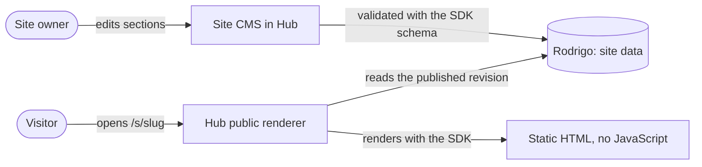
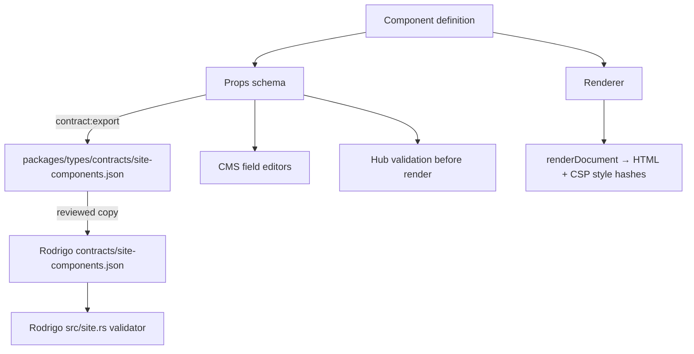

# @sorye/site-sdk

## At a glance

The Site SDK is the set of building blocks (Hero, Gallery, FAQ, Contact form and others) that workspace owners compose into a presentational website in the Site app. Each block is defined once and the same definition drives the CMS editing form, the checks Hub and Rodrigo apply when content is saved, and the static HTML that visitors receive.



An owner picks components and fills in their fields. Rodrigo stores and re-checks the content. When a visitor opens the site, Hub renders the published revision with this package into plain HTML.

## How it works

Every component has one **definition** in [`src/registry.tsx`](src/registry.tsx):

| Part | Used by |
| --- | --- |
| `type` and `version` | stored with each section; unknown types or versions are rejected |
| `props` (declarative schema in [`src/schema.ts`](src/schema.ts)) | the CMS form (labels, help, field kinds), Hub validation, and Rodrigo validation through the exported contract |
| `defaults()` | the starting props when a section is added |
| `render()` | server rendering to static HTML |



The schema is data, not code, so Rodrigo (Rust) interprets the same rules: every declared key must be present, unknown keys fail, `required` means non-empty, lengths count Unicode code points and text never contains control characters. Renderers only receive props that passed validation; invalid stored sections are skipped.

**Rendering.** Components are written in JSX but compiled against [`src/html.ts`](src/html.ts), a small runtime that renders directly to an escaped HTML string (no React, no hydration). It refuses `on*` handlers, `style` and raw HTML, and it works inside Next.js route handlers, where `react-dom/server` is not allowed. `renderDocument` produces a complete HTML document with the theme tokens and component CSS inlined as two `<style>` blocks. It returns their SHA-256 hashes, so Hub can send a Content-Security-Policy with `script-src 'none'` and no `unsafe-inline`. The mobile menu (`<details>`), FAQ (`<details>`), and gallery lightbox (the HTML `popover` attribute) work without JavaScript, so a page ships **0 KB of JavaScript**. The contact form is a plain form POST with a hidden honeypot field and a signed time token.

**Theme.** Five presets (`paper`, `midnight`, `forest`, `sunset`, `slate`) plus owner overrides become CSS custom properties. `validateTheme` rejects any combination that fails WCAG AA for text, muted text, button text, and links.

**Content.** Text fields hold per-locale values (`{ en, de, sk, hu, es }`) and fall back to the site's default locale. Rich text is a safe Markdown subset (paragraphs, two heading levels, lists, bold, italic, links) with no HTML. Links must be `https:`, `mailto:`, a site path such as `/about`, or a `#section`. Images come only from the site's media library; they carry width and height to avoid layout shift and require alt text.

**Migration.** [`src/legacy.ts`](src/legacy.ts) converts the earlier one-page Site blocks (Hero, About, Links, Storefront, Contact) into a CMS home page. The earlier record is left unchanged.

## Components

Header & navigation, Hero, Rich text, Features / services, Image + text, Gallery, Team, Testimonials, FAQ, Pricing table (display only), Call to action, Contact form, Collection list, Collection item, Logo strip, Footer, Links, and Product showcase (live Storefront names and prices, display only).

Open [`CATALOG.html`](CATALOG.html) for every component rendered with sample content and its props table.

## Development

```bash
pnpm --filter @sorye/site-sdk test
pnpm --filter @sorye/site-sdk lint
pnpm --filter @sorye/site-sdk contract:export   # after changing a schema; then copy into Rodrigo contracts/
pnpm --filter @sorye/site-sdk docs:catalog      # regenerates CATALOG.html
```

Changing a component's props needs a new `version` when stored content would no longer validate. Keep `src/site.rs` in Rodrigo in step with `src/schema.ts`; the contract snapshot test fails when the snapshot is stale.

Related: [Site app](../../docs/apps/APPS.md), [behavior map](../../docs/APP-BEHAVIOR-TREE.md), [Hub/Rodrigo boundary](../../docs/HUB-RODRIGO-BOUNDARY.md), [i18n](../../docs/I18N.md).
